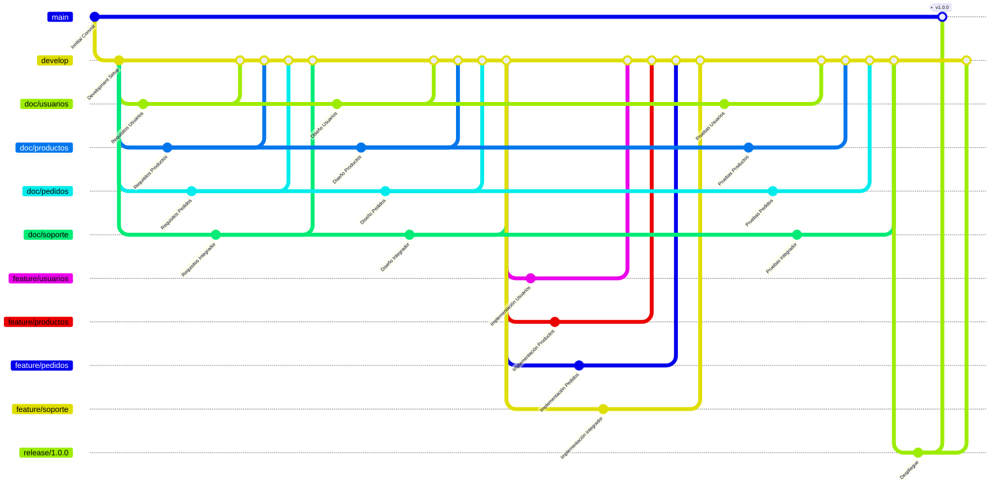

# Flujo de Trabajo

En este documento se describe la forma en la que se va a trabajar las contribuciones dentro del repositorio, es decir el flujo de trabajo.

> Un buen flujo de trabajo garantiza:
> - Organización
> - Estandarización
> - Colaboración
> - Trazabilidad
> - Calidad

## Tabla de Contenidos

- [Flujo de Trabajo](#flujo-de-trabajo)
  - [Tabla de Contenidos](#tabla-de-contenidos)
  - [Asignación de Tareas](#asignación-de-tareas)
  - [Calendario](#calendario)
    - [08-11-2026 (Requisitos)](#08-11-2026-requisitos)
    - [13-11-2026 (Diseño)](#13-11-2026-diseño)
    - [18-11-2026 (Implementación)](#18-11-2026-implementación)
    - [23-11-2026 (Pruebas y Despliegue)](#23-11-2026-pruebas-y-despliegue)
  - [Gitflow](#gitflow)
    - [Estrategia de Ramificación](#estrategia-de-ramificación)
    - [Diagrama de Gitflow](#diagrama-de-gitflow)
  - [Pull Requests](#pull-requests)
  - [Reglas de Trazabilidad y Consistencia](#reglas-de-trazabilidad-y-consistencia)
  - [Resolución de Conflictos](#resolución-de-conflictos)

## Asignación de Tareas

El desarrollo del proyecto será mediante el [**modelo incremental**](https://blog.comparasoftware.com/que-es-el-modelo-incremental/), el sistema queda dividido en 3 módulos que se trabajarán mediante incrementos en paralelo. Para cada incremento se seguirán las fases de: requisitos, diseño, implementación y pruebas. La responsabilidad de cada integrante es la siguiente:

* Jorge Revelo - Módulo de Usuarios (Clientes + Personal)
* Juan Chugá - Módulo de Productos (RU-01, RU-06)
* Bryan Ayala - Módulo de Pedidos (RU-02, RU-03, RU-04, RU-05, RU-07)
* Ricardo Garzón - Integrador

> Cada integrante debe definir contratos de integración (interfaces) con los demás módulos

## Calendario

Para la ejecución de cada fase se consideró adecuado un periodo de 5 días como máximo, de lo que se obtiene el siguiente calendario de hitos:

### 08-11-2026 (Requisitos)

* Jorge Revelo - Historias de usuario del Módulo de Usuarios (Clientes + Personal)
* Juan Chugá - Historias de usuario del Módulo de Productos (RU-01, RU-06)
* Bryan Ayala - Historias de usuario del Módulo de Pedidos (RU-02, RU-03, RU-04, RU-05, RU-07)
* Ricardo Garzón - Documentación de Ambiente + Flujo de Trabajo

> El integrador revisará y unificará las historias de usuario

### 13-11-2026 (Diseño)

* Jorge Revelo - Diagrama de clases del Módulo de Usuarios
* Juan Chugá - Diagrama de clases del Módulo de Productos
* Bryan Ayala - Diagrama de clases del Módulo de Pedidos
* Ricardo Garzón - Diagrama de Navegación + Prototipo de Interfaz

> El integrador revisará y unificará el diagrama de clases

### 18-11-2026 (Implementación)

* Jorge Revelo - Implementación del Módulo del Usuarios
* Juan Chugá - Implementación del Módulo de Productos
* Bryan Ayala - Implementación del Módulo de Pedidos
* Ricardo Garzón - Implementación del Menú Principal/Landing Page

> El integrador revisará e integrará los módulos del sistema

### 23-11-2026 (Pruebas y Despliegue)

* Jorge Revelo - Casos de prueba ejecutados + Manual de usuario del Módulo del Usuarios 
* Juan Chugá - Casos de prueba ejecutados + Manual de usuario del Módulo de Productos
* Bryan Ayala - Casos de prueba ejecutados + Manual de usuario del Módulo de Pedidos
* Ricardo Garzón - Análisis estático del código + Dockerización + Manual de Instalación

> El integrador unificará los casos de pruebas y el manual de usuario

## Gitflow

Para completar cada hito se seguirá la siguiente secuencia por cada integrante:

1. El integrador abre un *issue* de tipo *feature* con la tarea del hito
2. El integrador asigna el *issue* al integrante correspondiente
3. El integrante actualiza la rama correspondiente combinando los cambios de la rama *develop*
4. El integrante trabaja en la rama correspondiente hasta cumplir la tarea
5. El integrante realiza un *pull request* a la rama *develop*
6. El integrador revisa el *pull request* y lo combina a la rama *develop*

Una vez completados los hitos en la rama *develop* se crea una rama para el *release* y se combina a la rama *main*.

### Estrategia de Ramificación

* main - Para versiones funcionales
* develop - Para cada hito
* doc/usuarios - Para requisitos, diseño y pruebas del Módulo de Usuarios
* doc/productos - Para requisitos, diseño y pruebas del Módulo de Productos
* doc/pedidos - Para requisitos, diseño y pruebas del Módulo de Pedidos
* doc/soporte - Para requisitos, diseño y pruebas del integrador
* feature/usuarios - Para código del Módulo de Usuarios
* feature/productos - Para código del Módulo de Productos
* feature/pedidos - Para código del Módulo de Pedidos
* feature/soporte - Para código del integrador
* release/* - Para preparar una versión funcional
* hotfix/* - Para arreglos urgentes

### Diagrama de Gitflow

## Pull Requests

Para realizar pull requests se utilizará la plantilla descrita en [PULL_REQUEST_TEMPLATE.md](./PULL_REQUEST_TEMPLATE.md)

## Reglas de Trazabilidad y Consistencia

* Todo requisito debe tener un identificador único y versión.
* Todo *issue* debe referenciar los requisitos relacionados.
* Los commits deben seguir [Conventional Commits](https://www.conventionalcommits.org/en/v1.0.0/).
* Todo *pull request* debe referenciar su *issue* correspondiente.
* Los *issues* deben cerrarse cuando el trabajo esté efectivamente completado.
* Cada *release* debe tener un *milestone*
* Los cambios de requisitos deben quedar registrados.
* La documentación técnica debe incluir también los requisitos de negocio, requisitos de usuario, reglas de negocio y procesos de negocio que se cumplen.

## Resolución de Conflictos

* Los conflictos deben resolverse en la rama de trabajo.
* No se debe sobrescribir el trabajo de otros integrantes sin coordinación.
* Después de resolver conflictos debe probarse nuevamente.
* El integrador debe verificar que la integración no afecte otros módulos.