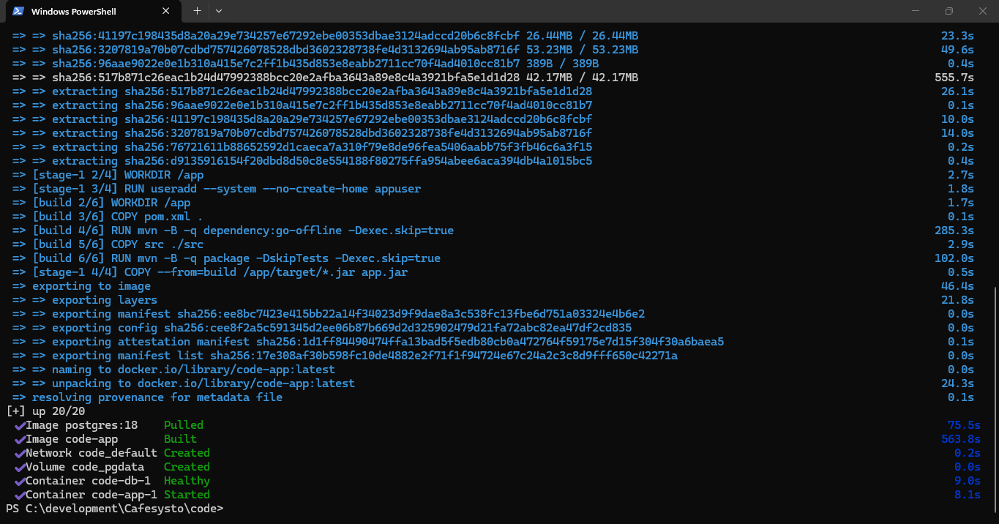
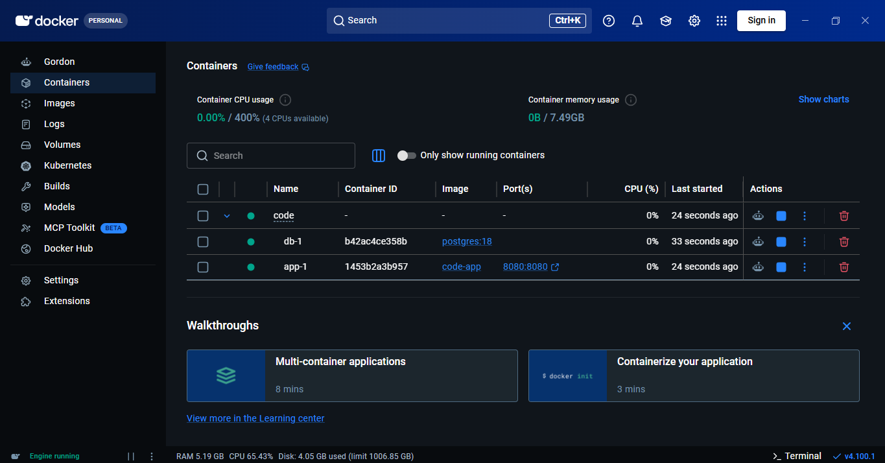
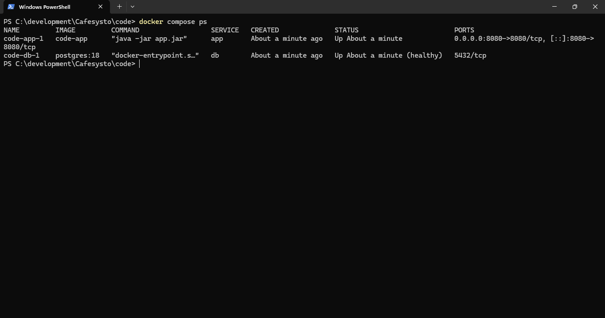
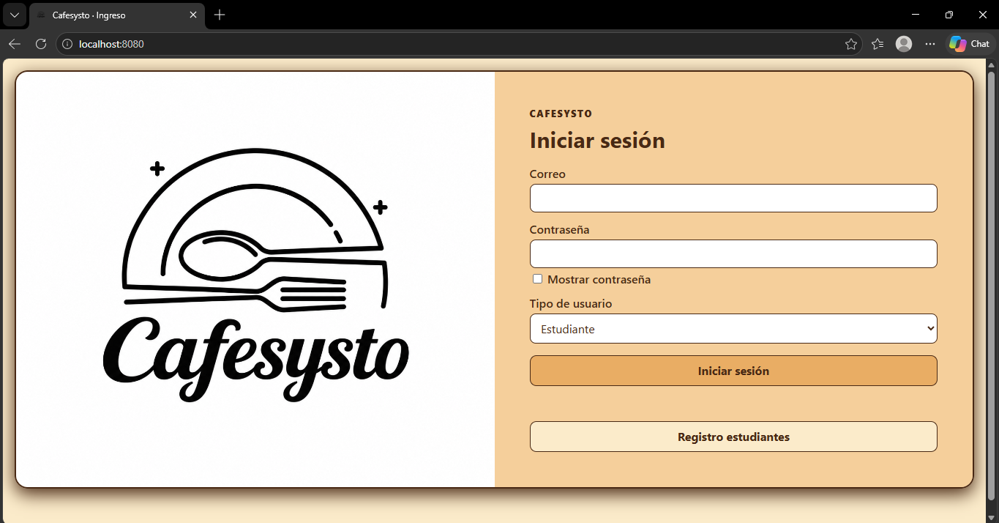
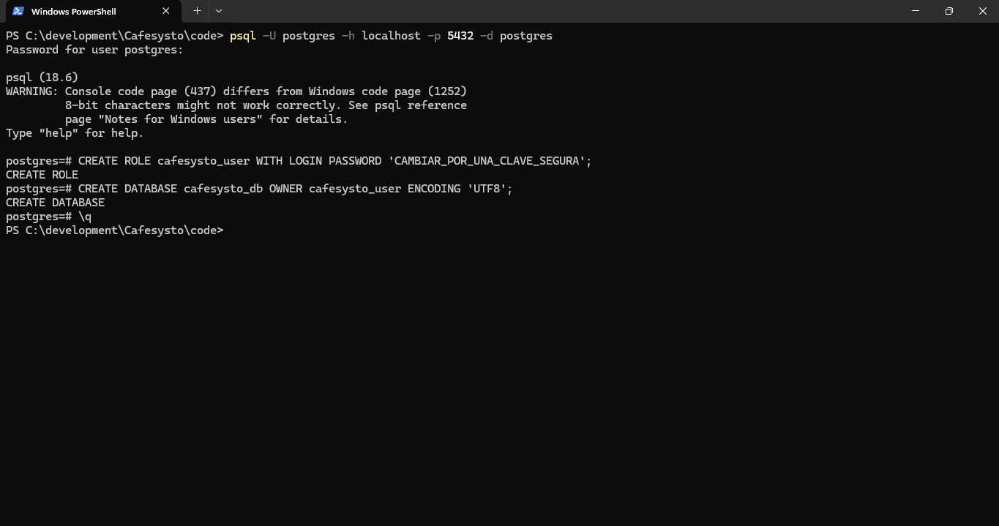

# Manual de Instalación

**Versión:** v1.0 <br>
**Autor:** Equipo 6 <br>

## Requisitos

Se necesita Git para descargar el proyecto. La opción A requiere Docker Desktop (Windows) o Docker Engine con Docker Compose (Linux). La opción B requiere Java JDK 21, Node.js con npm y PostgreSQL 18 o superior. Maven no necesita instalarse: el proyecto incluye Maven Wrapper.

En los pasos siguientes, la carpeta raíz de trabajo es la carpeta del repositorio clonado (la que contiene `pom.xml`, `mvnw.cmd` y `docker-compose.yml`). Ejecutar desde esa carpeta todos los comandos indicados, salvo que se especifique otra ubicación.

## Opción A: Utilizando Docker

El procedimiento es válido con Docker Compose: levanta PostgreSQL y la aplicación, y espera a que la base de datos esté lista antes de iniciar la aplicación. Siga estos pasos y reemplace todas las credenciales de ejemplo por valores propios y seguros.

1. Instalar [Git](https://git-scm.com/downloads) y Docker Desktop para [Windows](https://www.docker.com/products/docker-desktop/) o Docker Engine y Compose para [Linux](https://docs.docker.com/engine/install/).
2. Clonar el repositorio:

   ```powershell
   git clone https://github.com/RDGS2005/Cafesysto
   ```

3. En PowerShell, entrar a la carpeta del repositorio:

   ```powershell
   cd .\Cafesysto
   ```

4. Crear en la carpeta actual el archivo `.env` con este contenido:

   ```dotenv
   DB_URL=jdbc:postgresql://localhost:5432/cafesysto_db?stringtype=unspecified
   DB_USER=USUARIO_POSTGRES
   DB_PASSWORD=CLAVE_SEGURA_POSTGRES
   CAFESYSTO_CORREO_DOMINIO=uni.edu.ec
   CAFESYSTO_ADMIN_USUARIO=admin@administracion.uni.edu.ec
   CAFESYSTO_ADMIN_CLAVE=CLAVE_SEGURA_ADMIN
   ```

   Cambiar `DB_USER` y `DB_PASSWORD` por credenciales que se utilizarán para la base de datos. Reemplazar `uni.edu.ec` por el dominio institucional y configurar el correo y la clave del administrador de la aplicación. No usar `admin123` ni publicar el archivo `.env`.

5. Construir e iniciar los contenedores:

   ```powershell
   docker compose up --build -d
   ```

   

   Compose crea la base `cafesysto_db` con el usuario y la clave indicados. Dentro de Docker, la aplicación se conecta al servicio `db`; por ello, el `DB_URL` definido en el archivo `.env` se sustituye por la dirección interna del contenedor.

   

6. Esperar a que termine la compilación y verificar que ambos servicios estén activos:

   ```powershell
   docker compose ps
   ```

   

7. Abrir [http://localhost:8080](http://localhost:8080) para comprobar que la aplicación responde.

   

## Opción B: PostgreSQL local y compilación con Maven

1. Instalar [Git](https://git-scm.com/downloads), [Java JDK 21](https://www.oracle.com/java/technologies/downloads/#java21), [Node.js y npm](https://nodejs.org/en/download) y [PostgreSQL 18 o superior](https://www.postgresql.org/download/). Durante la instalación de PostgreSQL, guardar la clave del usuario administrador `postgres`.
   
2. Clonar el repositorio y entrar en la carpeta raíz de trabajo:

   ```powershell
   git clone https://github.com/RDGS2005/Cafesysto
   cd .\Cafesysto
   ```

3. Crear un usuario y la base de datos. Abrir SQL Shell (psql) o ejecutar `psql -U postgres -h localhost -p 5432 -d postgres`, autenticarse con la clave definida al instalar PostgreSQL y ejecutar:

   ```sql
   CREATE ROLE cafesysto_user WITH LOGIN PASSWORD 'CAMBIAR_POR_UNA_CLAVE_SEGURA';
   CREATE DATABASE cafesysto_db OWNER cafesysto_user ENCODING 'UTF8';
   ```

   Usar una clave segura en lugar del texto de ejemplo. Las migraciones de Flyway crean el esquema al iniciar la aplicación; no ejecutar los scripts SQL manualmente. Salir de psql con `\q`.

   

4. Copiar el archivo de ejemplo de variables de entorno a `.env`:

   ```powershell
   Copy-Item .\.env-example .\.env
   ```

   Editar `.env` y ajustar al menos `DB_USER` y `DB_PASSWORD` para que coincidan con el rol creado en PostgreSQL. Revisar también el dominio institucional y sustituir las credenciales de administrador de ejemplo por valores propios y seguros. No publicar `.env`.

5. Compilar y empaquetar el proyecto:

   ```powershell
   .\mvnw.cmd clean package
   ```

   El wrapper descarga la versión de Maven configurada por el proyecto. El proceso también ejecuta `npm ci` y las pruebas con cobertura JavaScript; por eso Node.js y npm deben estar instalados.

6. Manteniéndose en la carpeta raíz del repositorio, iniciar el JAR generado:

   ```powershell
   java -jar .\target\cafeteria-1.0.0-SNAPSHOT.jar
   ```

7. Abrir [http://localhost:8080](http://localhost:8080). Para detener la aplicación, presionar `Ctrl+C` en la terminal.

   