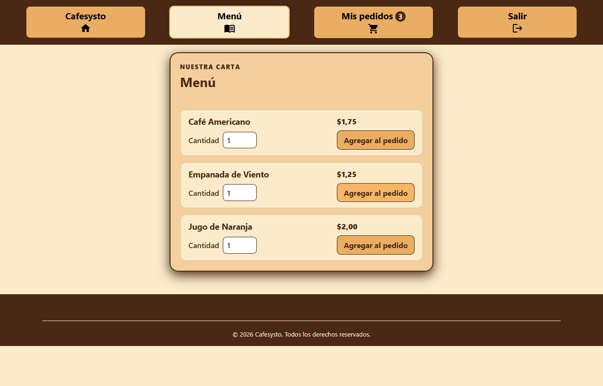
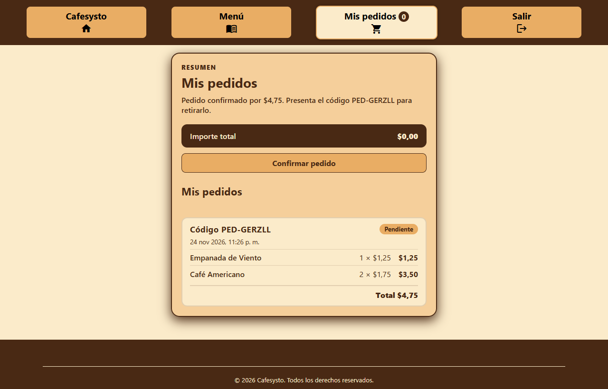
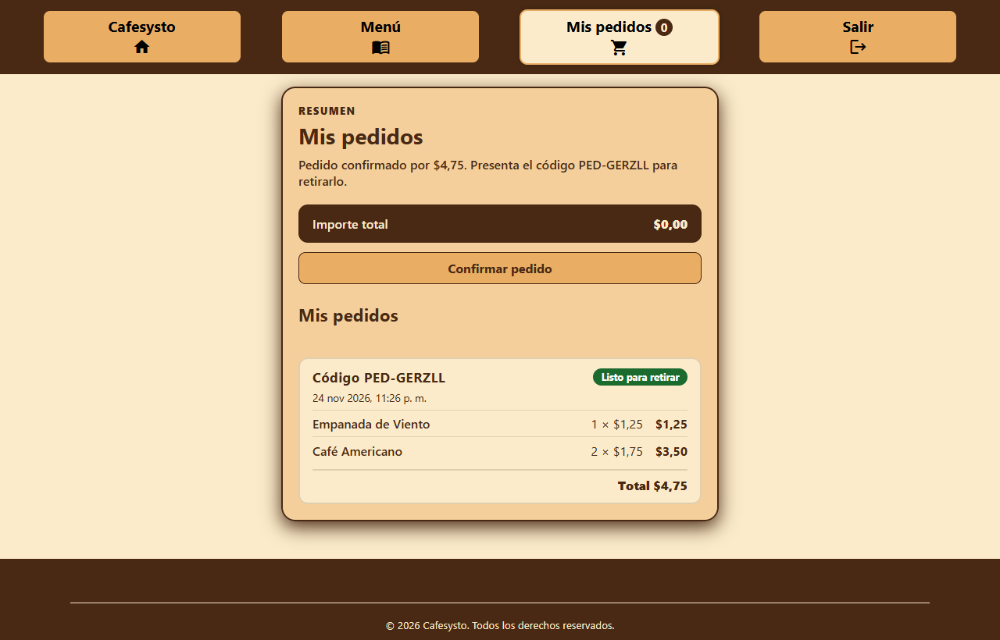
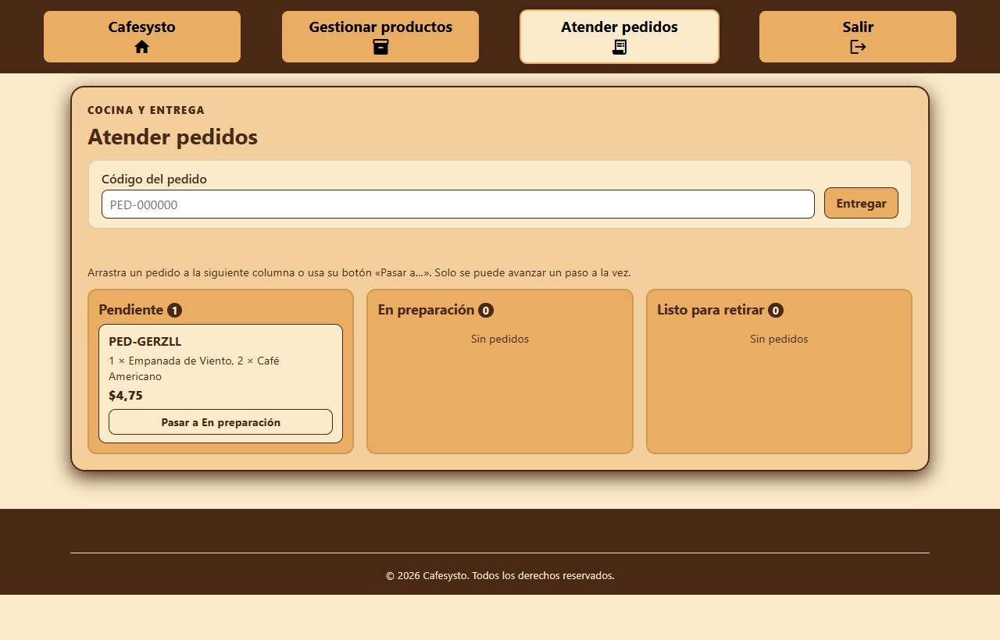
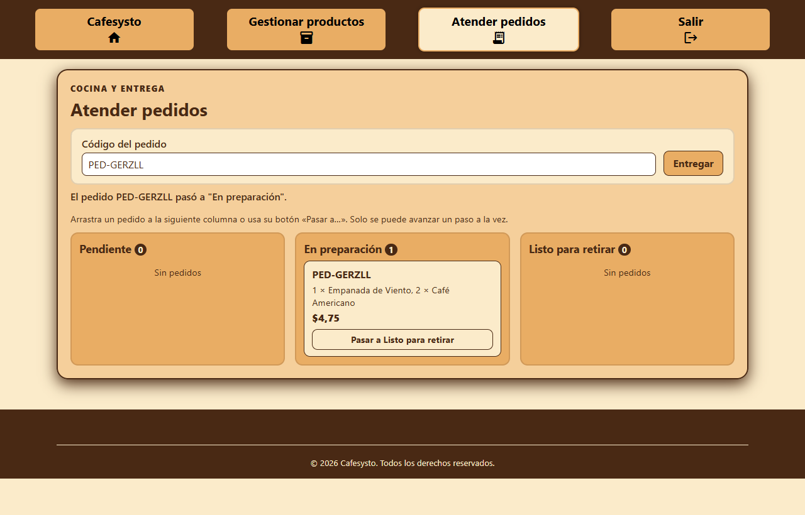
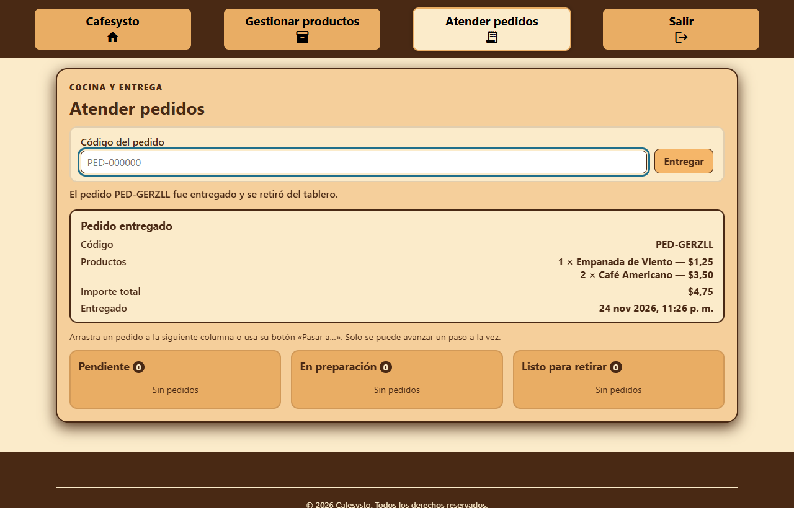

# Manual de Usuario

**Versión:** v0.0
**Autor:** Equipo 6

- [Manual de Usuario](#manual-de-usuario)
  - [1. Cliente](#1-cliente)
    - [1.1. ¿Cómo registrarse?](#11-cómo-registrarse)
    - [1.2. ¿Cómo iniciar sesión?](#12-cómo-iniciar-sesión)
    - [1.3. ¿Cómo consultar el menú?](#13-cómo-consultar-el-menú)
    - [1.4. ¿Cómo agregar productos (comida, bebida) a mi pedido?](#14-cómo-agregar-productos-comida-bebida-a-mi-pedido)
    - [1.5. ¿Cómo confirmar mi pedido?](#15-cómo-confirmar-mi-pedido)
    - [1.6. ¿Cómo consultar el estado de mi pedido?](#16-cómo-consultar-el-estado-de-mi-pedido)
    - [1.7. ¿Cómo retirar mi pedido?](#17-cómo-retirar-mi-pedido)
  - [2. Personal](#2-personal)
    - [2.1. ¿Cómo iniciar sesión?](#21-cómo-iniciar-sesión)
    - [2.2. ¿Cómo consultar los productos?](#22-cómo-consultar-los-productos)
    - [2.3. ¿Cómo registrar un nuevo producto (comida, bebida)?](#23-cómo-registrar-un-nuevo-producto-comida-bebida)
    - [2.4. ¿Cómo cambiar el precio de un producto?](#24-cómo-cambiar-el-precio-de-un-producto)
    - [2.5. ¿Cómo cambiar la disponibilidad de un producto?](#25-cómo-cambiar-la-disponibilidad-de-un-producto)
    - [2.6. ¿Cómo consultar los pedidos de los clientes?](#26-cómo-consultar-los-pedidos-de-los-clientes)
    - [2.7. ¿Cómo avanzar un pedido?](#27-cómo-avanzar-un-pedido)
    - [2.8. ¿Cómo entregar un pedido?](#28-cómo-entregar-un-pedido)
  - [3. Administrador](#3-administrador)
    - [3.1. ¿Cómo iniciar sesión?](#31-cómo-iniciar-sesión)
    - [3.2. ¿Cómo cambiar la clave?](#32-cómo-cambiar-la-clave)
    - [3.3. ¿Cómo registrar a un miembro del personal?](#33-cómo-registrar-a-un-miembro-del-personal)

## 1. Cliente

### 1.1. ¿Cómo registrarse?

### 1.2. ¿Cómo iniciar sesión?

### 1.3. ¿Cómo consultar el menú?

### 1.4. ¿Cómo agregar productos (comida, bebida) a mi pedido?

1. Ingrese a la pestaña **Menú** desde la barra de navegación superior del panel de Cliente.
2. En la tarjeta del producto que desea ordenar, indique la **Cantidad** (número entero entre `1` y `99`).
3. Pulse **Agregar al pedido**.
4. Repita el proceso para añadir otros productos; el contador junto a **Mis pedidos** mostrará el total de unidades acumuladas.

### 1.5. ¿Cómo confirmar mi pedido?

1. Pulse **Mis pedidos** en la barra superior.
2. Revise el listado de productos, cantidades, subtotales y el **Importe total** (puede pulsar **Retirar** si desea quitar un artículo antes de confirmar).
3. Pulse **Confirmar pedido**.
4. El sistema registrará el pedido en estado **Pendiente**, vaciará la selección en curso y mostrará su **código único de retiro** (`PED-XXXXXX`). Conserve este código para presentarlo en mostrador.

### 1.6. ¿Cómo consultar el estado de mi pedido?

1. Abra la pestaña **Mis pedidos** en su sesión de Cliente.
2. En el listado inferior de pedidos confirmados, ubique la tarjeta de su pedido por su código de retiro.
3. Revise la etiqueta de estado (**Pendiente**, **En preparación**, **Listo para retirar** o **Entregado**), que se actualiza automáticamente conforme avanza la atención.

### 1.7. ¿Cómo retirar mi pedido?

*Nota: El pago y el retiro físico del pedido se realizan fuera de la aplicación, directamente en el mostrador de la cafetería.*

1. Verifique en **Mis pedidos** que el estado de su pedido aparezca como **Listo para retirar**.
2. Acérquese al mostrador de la cafetería y realice el pago presencial por el importe total indicado en su pedido.
3. Indique o muestre al personal su **código de retiro** (`PED-XXXXXX`).
4. Una vez validado el código, el personal le entregará sus productos y registrará el pedido como **Entregado** en el sistema.

## 2. Personal

### 2.1. ¿Cómo iniciar sesión?

### 2.2. ¿Cómo consultar los productos?

### 2.3. ¿Cómo registrar un nuevo producto (comida, bebida)?

### 2.4. ¿Cómo cambiar el precio de un producto?

### 2.5. ¿Cómo cambiar la disponibilidad de un producto?

### 2.6. ¿Cómo consultar los pedidos de los clientes?

1. Inicie sesión con su cuenta de **Personal** y pulse **Atender pedidos** en la barra superior.
2. Revise el tablero organizado en tres columnas: **Pendiente**, **En preparación** y **Listo para retirar**.
3. Cada tarjeta muestra el código de retiro, el detalle de productos y el importe total. Los pedidos entregados salen automáticamente del tablero.

### 2.7. ¿Cómo avanzar un pedido?

1. En **Atender pedidos**, ubique la tarjeta del pedido que desea actualizar.
2. Para pasar de **Pendiente** a **En preparación**, pulse **Pasar a En preparación** (también puede arrastrar y soltar la tarjeta hacia la columna siguiente).
3. Cuando el pedido esté listo, pulse **Pasar a Listo para retirar** (o arrastre la tarjeta a la columna **Listo para retirar**).
4. Cada pedido solo avanza un paso a la vez y no se puede devolver a una columna anterior.

### 2.8. ¿Cómo entregar un pedido?

1. Confirme que el pedido se encuentre en la columna **Listo para retirar**.
2. Verifique el pago presencial del cliente y solicite su código de retiro (`PED-XXXXXX`).
3. En el campo **Código del pedido** de la parte superior, ingrese el código y pulse **Entregar**.
4. El sistema validará el código, mostrará el resumen en **Pedido entregado** y retirará la tarjeta del tablero.

## 3. Administrador

### 3.1. ¿Cómo iniciar sesión?

### 3.2. ¿Cómo cambiar la clave?

### 3.3. ¿Cómo registrar a un miembro del personal?
