# DCG — Diagrama de Clases General

**Versión:** v1.0  
**Autor:** Equipo 6  

## Trazabilidad

- Issue: #15
- Pull Request: #22

## Diagrama

```mermaid
classDiagram

namespace Usuarios {

    class UsuarioController {
        -usuarioService: UsuarioService
        +registrarCliente(datos): Cliente
        +registrarPersonal(contexto, datos): Personal
    }

    class AutenticacionController {
        -autenticacionService: AutenticacionService
        +autenticar(correo, clave): Usuario
        +cambiarClaveAdministrador(contexto, actual, nueva, confirmacion)
    }

    class UsuarioService {
        -usuarioRepository: UsuarioRepository
        -claveHasher: ClaveHasher
        -autenticacionService: AutenticacionService
        +registrarCliente(datos): Cliente
        +registrarPersonal(contexto, datos): Personal
        -validarDatosCliente(datos)
        -validarUnicidad(cedula, correo)
        -generarCodigoCliente(): String
    }

    class AutenticacionService {
        -usuarioRepository: UsuarioRepository
        -claveHasher: ClaveHasher
        +ingresarCliente(correo, clave): Cliente
        +ingresarPersonal(correo, clave): Personal
        +ingresarAdministrador(nombreUsuario, clave): Administrador
        +exigirRol(contexto, rol): Usuario
        +obtenerClienteAutenticado(contexto): Cliente
        +exigirAdministradorSinBloqueo(contexto): Administrador
        +cambiarClaveAdministrador(contexto, actual, nueva, confirmacion)
        -validarCambioClave(actual, nueva, confirmacion, administrador)
    }

    class ContextoAutenticado {
        -identificador: String
        -rol: RolUsuario
    }

    class UsuarioRepository {
        <<interface>>
        +guardar(usuario): Usuario
        +buscarPorCedula(cedula): Usuario
        +buscarPorCorreo(correo): Usuario
        +buscarPorCodigoCliente(codigoCliente): Cliente
        +existeCodigoCliente(codigoCliente): boolean
        +actualizarCredenciales(administrador)
    }

    class ClaveHasher {
        <<interface>>
        +generarHash(clave): String
        +verificar(clave, hash): boolean
    }

    class Usuario {
        <<abstract>>
        -claveHash: String
        +obtenerClaveHash(): String
        +obtenerTokenAcceso(): String
        +obtenerRol(): RolUsuario
    }

    class Persona {
        <<abstract>>
        -nombre: String
        -apellido: String
        -cedula: String
        -celular: String
        -correo: String
        +obtenerCedula(): String
        +obtenerCorreo(): String
        +obtenerTokenAcceso(): String
    }

    class Cliente {
        -codigo: String
        +obtenerCodigo(): String
        +obtenerRol(): RolUsuario
    }

    class Personal {
        +obtenerRol(): RolUsuario
    }

    class Administrador {
        -nombreUsuario: String
        -requiereCambioClave: boolean
        +debeCambiarClave(): boolean
        +actualizarClave(nuevoHash)
        +obtenerTokenAcceso(): String
        +obtenerRol(): RolUsuario
    }

    class RolUsuario {
        <<enumeration>>
        CLIENTE
        PERSONAL
        ADMINISTRADOR
    }

}

namespace Productos {

    class ProductoController {
        -productoService: ProductoService
        +consultarMenu(): List~Producto~
        +listarProductos(contexto): List~Producto~
        +registrarProducto(contexto, datos): Producto
        +actualizarPrecio(contexto, codigo, precio)
        +actualizarDisponibilidad(contexto, codigo, estado)
    }

    class ProductoService {
        -productoRepository: ProductoRepository
        -autenticacionService: AutenticacionService
        +obtenerMenu(): List~Producto~
        +listarTodos(contexto): List~Producto~
        +registrar(contexto, datos): Producto
        +actualizarPrecio(contexto, codigo, precio)
        +actualizarDisponibilidad(contexto, codigo, estado)
        +buscarPorCodigo(codigo): Producto
        +estaDisponible(codigo): boolean
        +obtenerPrecioVigente(codigo): Decimal
        -validarPrecio(precio): boolean
        -validarNombreUnico(nombre): boolean
        -generarCodigo(): String
    }

    class ProductoRepository {
        <<interface>>
        +guardar(producto): Producto
        +buscarPorCodigo(codigo): Producto
        +existeNombre(nombre): boolean
        +buscarTodos(): List~Producto~
        +buscarDisponibles(): List~Producto~
        +actualizar(producto)
    }

    class Producto {
        -codigo: String
        -nombre: String
        -precio: Decimal
        -estado: EstadoProducto
        +cambiarPrecio(nuevoPrecio)
        +cambiarDisponibilidad(estado)
        +estaDisponible(): boolean
    }

    class EstadoProducto {
        <<enumeration>>
        DISPONIBLE
        NO_DISPONIBLE
    }

}

namespace Pedidos {

    class PedidoController {
        -pedidoService: PedidoService
        +seleccionarProducto(codigoProducto, cantidad): DetallePedido
        +calcularTotalPrevio(detalles): Decimal
        +confirmarPedido(contexto, detalles): Pedido
        +consultarEstadoPedido(contexto, codigoRetiro): EstadoPedido
        +consultarMisPedidos(contexto): List~Pedido~
        +consultarPedidos(contexto): List~Pedido~
        +consultarPedidosPorEstado(contexto, estado): List~Pedido~
        +consultarDetallePedido(contexto, codigoRetiro): Pedido
        +avanzarEstadoPedido(contexto, codigoRetiro): Pedido
        +registrarEntregaPedido(contexto, codigoRetiro, codigoPresentado): Pedido
    }

    class PedidoService {
        -pedidoRepository: PedidoRepository
        -productoService: ProductoService
        -autenticacionService: AutenticacionService
        +crearDetalleSeleccion(codigoProducto, cantidad): DetallePedido
        +calcularImporteTotal(detalles): Decimal
        +confirmarPedido(contexto, detalles): Pedido
        +consultarEstado(contexto, codigoRetiro): EstadoPedido
        +consultarMisPedidos(contexto): List~Pedido~
        +consultarPedidos(contexto): List~Pedido~
        +listarPorEstado(contexto, estado): List~Pedido~
        +buscarPorCodigoRetiro(contexto, codigoRetiro): Pedido
        +avanzarEstado(contexto, codigoRetiro): Pedido
        +entregarPedido(contexto, codigoRetiro, codigoPresentado): Pedido
        -validarSeleccion(detalles): boolean
        -validarCantidadPositiva(cantidad): boolean
        -validarTransicionEstado(estadoActual, nuevoEstado): boolean
        -validarCodigoRetiro(pedido, codigoPresentado): boolean
        -generarCodigoRetiro(): String
    }

    class PedidoRepository {
        <<interface>>
        +guardar(pedido): Pedido
        +buscarPorCodigoRetiro(codigoRetiro): Pedido
        +existeCodigoRetiro(codigoRetiro): boolean
        +buscarTodos(): List~Pedido~
        +buscarPorEstado(estado): List~Pedido~
        +buscarPorCliente(codigoCliente): List~Pedido~
        +actualizar(pedido): void
    }

    class Pedido {
        -codigoRetiro: String
        -fechaRegistro: Date
        -total: Decimal
        -estado: EstadoPedido
        +calcularTotal(): Decimal
        +agregarDetalle(detalle): void
        +eliminarDetalle(detalle): void
        +cambiarEstado(nuevoEstado): void
        +estaListoParaRetirar(): boolean
        +verificarCodigoRetiro(codigoPresentado): boolean
    }

    class DetallePedido {
        -cantidad: Integer
        -precioUnitario: Decimal
        -subtotal: Decimal
        +calcularSubtotal(): Decimal
        +actualizarCantidad(nuevaCantidad): void
    }

    class EstadoPedido {
        <<enumeration>>
        PENDIENTE
        EN_PREPARACION
        LISTO_PARA_RETIRAR
        ENTREGADO
    }

}

    %% Controladores -> servicios
    UsuarioController --> UsuarioService : utiliza
    AutenticacionController --> AutenticacionService : utiliza
    ProductoController --> ProductoService : utiliza
    PedidoController --> PedidoService : utiliza

    %% Servicios -> repositorios y utilidades
    UsuarioService --> UsuarioRepository : utiliza
    UsuarioService --> ClaveHasher : utiliza
    UsuarioService --> AutenticacionService : autoriza registro
    AutenticacionService --> UsuarioRepository : utiliza
    AutenticacionService --> ClaveHasher : utiliza
    ProductoService --> ProductoRepository : utiliza
    PedidoService --> PedidoRepository : utiliza

    %% Persistencia
    UsuarioRepository ..> Usuario : persiste
    ProductoRepository ..> Producto : persiste
    PedidoRepository ..> Pedido : persiste

    %% Servicios y entidades de Usuarios
    UsuarioService ..> Cliente : crea
    UsuarioService ..> Personal : crea
    AutenticacionService ..> Usuario : consulta y valida
    AutenticacionService ..> Cliente : obtiene
    AutenticacionService ..> Administrador : valida
    AutenticacionService ..> ContextoAutenticado : interpreta

    %% Jerarquía de usuarios
    Usuario <|-- Persona
    Persona <|-- Cliente
    Persona <|-- Personal
    Usuario <|-- Administrador
    Usuario ..> RolUsuario : determina segun subtipo

    %% Entidades de Productos
    Producto --> EstadoProducto : estado

    %% Entidades de Pedidos
    Pedido "1" *-- "1..*" DetallePedido : contiene
    Pedido --> EstadoPedido : estado
    DetallePedido "*" --> "1" Producto : referencia
    Pedido "*" --> "1" Cliente : pertenece a
    Pedido "*" --> "0..1" Personal : procesado por

    %% Dependencias entre módulos (Pedidos -> Productos, Pedidos -> Usuarios, Productos -> Usuarios; nunca al revés, RNF-05)
    PedidoService ..> ProductoService : consulta
    PedidoService ..> AutenticacionService : verifica identidad y rol
    ProductoService ..> AutenticacionService : exige PERSONAL
```

## Observaciones

- Arquitectura MVC: cada módulo conserva su controlador, sus servicios, su contrato de repositorio y sus entidades.
- Dirección de las dependencias: Pedidos depende de Productos y Usuarios; Productos depende de Usuarios; Usuarios no depende de ninguno.
- Cambios para unificar criterios entre los tres diagramas:
    - **UsuarioService de DCP eliminado.** Era un stub provisional (`buscarClientePorCedula`, `validarPersonalActivo`). Pedidos usa ahora `AutenticacionService` (`exigirRol`, `obtenerClienteAutenticado`), que es lo que define DCU.
    - **Identidad por contexto, no por cédula.** Las operaciones de Pedidos que recibían `cedulaCliente` o `cedulaPersonal` ahora reciben `contexto` (ContextoAutenticado), como pide DCU: la identidad la valida el servidor y no se acepta un código de cliente libre desde el formulario. `consultarPedidosCliente` pasa a llamarse `consultarMisPedidos` (RFU-02, RFP-04). `PedidoRepository.buscarPorCliente` recibe el código del cliente, que el servicio obtiene del cliente autenticado.
    - **Productos exige PERSONAL.** `registrarProducto`, `actualizarPrecio`, `actualizarDisponibilidad` y `listarTodos` reciben `contexto`, y `ProductoService` verifica el rol con `AutenticacionService` (RFU-04, RFM-02, RFM-03-1, RFM-03-2). `consultarMenu` / `obtenerMenu` siguen siendo públicos para el cliente (RFM-01). `buscarPorCodigo`, `estaDisponible` y `obtenerPrecioVigente` no cambian porque son consultas internas que usa Pedidos.
    - **Código de cliente.** La especificación del cliente (sección 7) define al Cliente como una persona identificada mediante un código, además de sus datos. Por eso `Cliente` tiene el atributo `codigo` (`obtenerCodigo`). Se eliminó el atributo `codigoCliente` de `Pedido`, porque la asociación `Pedido → Cliente` ya expresa la relación y el pedido se vincula al cliente por ese código. `UsuarioRepository` incorpora `buscarPorCodigoCliente` y `existeCodigoCliente`.
    - **Hasher.** Se unificó el nombre como `ClaveHasher` (DCU lo nombraba también `ContrasenaHasher` en el texto).
    - **ContextoAutenticado** y `AutenticacionService.obtenerClienteAutenticado` aparecían solo en las observaciones de DCU; ahora figuran en el diagrama.
    - Se eliminó la relación duplicada `AutenticacionService ..> Usuario : crea`, que contradecía a `consulta y valida`; `UsuarioRepositoryImpl` no se incluye porque es un detalle de implementación y los otros módulos no definen el suyo.
- Reglas heredadas sin cambios: el pedido se guarda solo al confirmar, en PENDIENTE y con código de retiro único (RN-NEG-05, RN-NEG-06); `DetallePedido` guarda su propio `precioUnitario` (RN-NEG-04); el estado avanza en orden sin saltos ni retrocesos (RFP-05-2); la entrega exige estado LISTO_PARA_RETIRAR y el código de retiro (RN-NEG-07); los productos no se borran, se marcan NO_DISPONIBLE (RFM-03-2).
- Generación automática del código de cliente: el código lo genera el sistema (`UsuarioService.generarCodigoCliente`) al registrar al cliente. No es un dato del formulario ni se acepta desde `datos` en `registrarCliente`. Debe ser único (verificable con `existeCodigoCliente`, y garantizado por la implementación del repositorio incluso ante registros simultáneos) y no cambia después del registro. De la misma forma, el código de retiro de un pedido lo genera el sistema (`generarCodigoRetiro`) al confirmarlo (RN-NEG-05), y el código de producto lo genera `ProductoService.generarCodigo`.
- Alcance frente a la especificación del cliente: el documento del cliente solo menciona Cliente y Personal. El Administrador, el inicio de sesión, el registro de personal y los roles (RFU-01, RFU-02, RFU-04, RFU-05, RFU-06) son decisiones del equipo derivadas del análisis. No contradicen la especificación, pero deben tratarse como alcance propio y no como requisito explícito del cliente.
- Entrega solo con código (RN-NEG-07): `avanzarEstado` solo debe llevar el pedido de PENDIENTE a EN_PREPARACION y de EN_PREPARACION a LISTO_PARA_RETIRAR. El paso a ENTREGADO se realiza únicamente con `entregarPedido`, que exige el estado LISTO_PARA_RETIRAR y el código de retiro correcto. `validarTransicionEstado` debe rechazar el paso a ENTREGADO desde `avanzarEstado`.
- Motivo de rechazo (PN-01, paso 7): cuando la selección no cumple las reglas (sin productos, cantidad no positiva o producto no disponible, RN-NEG-01 y RN-NEG-02), el sistema debe informar el motivo y no confirmar el pedido. El diagrama no modela el resultado de la validación; durante la implementación debe resolverse con excepciones o mensajes de validación que la vista pueda mostrar.
- Validación de propiedad: `consultarEstado` y `buscarPorCodigoRetiro` deben limitar a un CLIENTE a sus propios pedidos y permitir al PERSONAL consultar cualquiera (RFU-02, RFP-05-1). Es una regla de servicio, no se refleja como método separado.