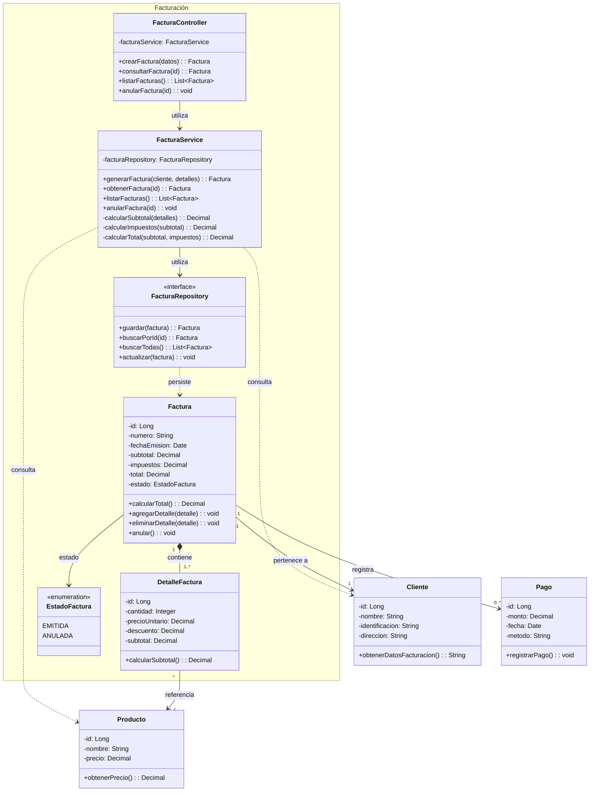

# DCF — Diagrama de Clases Módulo de Facturación

## Diagrama

## Versión

v1.0

## Trazabilidad

- Issue: #1
- Pull Request: #2

## Observaciones

Espacio para aclaraciones o decisiones de análisis.