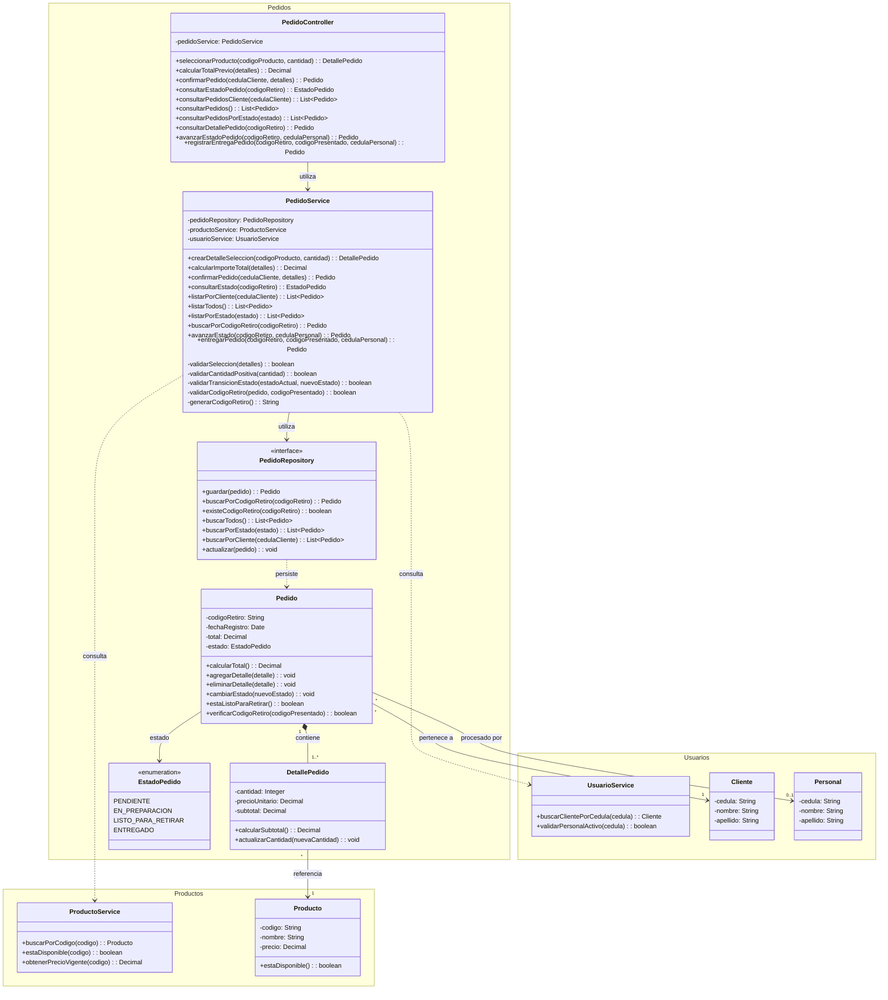

# DCP — Diagrama de Clases Módulo de Pedidos

## Diagrama

## Versión

v1.0

## Trazabilidad

- Issue: #13
- Pull Request: Pendiente

## Observaciones

- Arquitectura MVC:
    - Modelo: Pedido, DetallePedido, EstadoPedido, PedidoService, PedidoRepository.
    - Controlador: PedidoController.
    - Vista: no aparece hasta el prototipo de la interfaz.
- Pedidos depende de Productos y Usuarios, y no al revés (RNF-05).
- Se usan los métodos de ProductoService definidos en DCM.md (buscarPorCodigo, estaDisponible y obtenerPrecioVigente) para validar los productos y calcular el importe (RN-NEG-02, RN-NEG-03, RFP-01, RFP-02).
- El pedido solo se guarda cuando el cliente lo confirma. Se registra en PENDIENTE y con un código de retiro único (RFP-03, RN-NEG-05, RN-NEG-06).
- DetallePedido guarda su propio precioUnitario, así que un cambio de precio en el menú no afecta a los pedidos ya confirmados (RN-NEG-04).
- El cliente consulta el estado de sus pedidos (RFP-04) y el personal consulta todos los pedidos con su código de retiro (RFP-05-1).
- El estado solo avanza en orden: PENDIENTE, EN_PREPARACION, LISTO_PARA_RETIRAR y ENTREGADO, sin saltar ni retroceder (RFP-05-2, RN-NEG-06).
- Para marcar un pedido como ENTREGADO tiene que estar LISTO_PARA_RETIRAR y el cliente debe presentar su código de retiro (RFP-05-2, RN-NEG-07).
- El namespace Usuarios es provisional porque DCU.md todavía no está hecho. Los métodos de UsuarioService deben coincidir con los que se definan en ese módulo.
