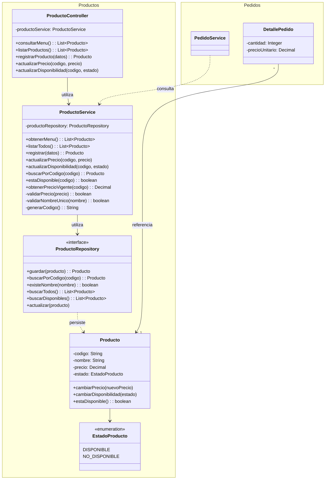

# DCM — Diagrama de Clases Módulo de Productos

## Diagrama

## Versión

v1.0

## Trazabilidad

- Issue: #12
- Pull Request: Pendiente

## Observaciones

- Arquitectura MVC: 
    - Modelo: Producto, EstadoProducto, ProductoService.
    - Controlador: ProductoController,
    - Vista: no aparece hasta el prototipo de la interfaz.
- Los pedidos dependen de los productos y no al revés (RNF-05).
- ProductoService expone buscarPorCodigo, estaDisponible y obtenerPrecioVigente para que Pedidos valide la disponibilidad y calcule el importe (RN-NEG-02, RN-NEG-03, RFP-01, RFP-02).
- DetallePedido deberá guardar su propio precioUnitario, así que un cambio de precio en el menú no afecta a los pedidos ya confirmados (RN-NEG-04).
- Producto no tiene métodos para cambiar el código ni el nombre (RFM-02, RFM-03-1, RFM-03-2).
- Los productos no se borran, se marcan como NO_DISPONIBLE, para no afectar a los pedidos existentes (RFM-03-2).
- Para aclarar las consultas: obtenerMenu devuelve solo los productos disponibles, para el cliente (RFM-01). listarTodos devuelve todos, para que el personal pueda volver a habilitarlos (RFM-03-2).
- Todo producto se registra como DISPONIBLE salvo que el personal indique lo contrario (RFM-02).
- Solo el personal puede registrar o editar los productos, y el personal es controlado por el módulo de usuarios (RFU-04).
- El namespace Pedidos es provisional y solo tiene los métodos y atributos necesarios para interactuar con Productos.