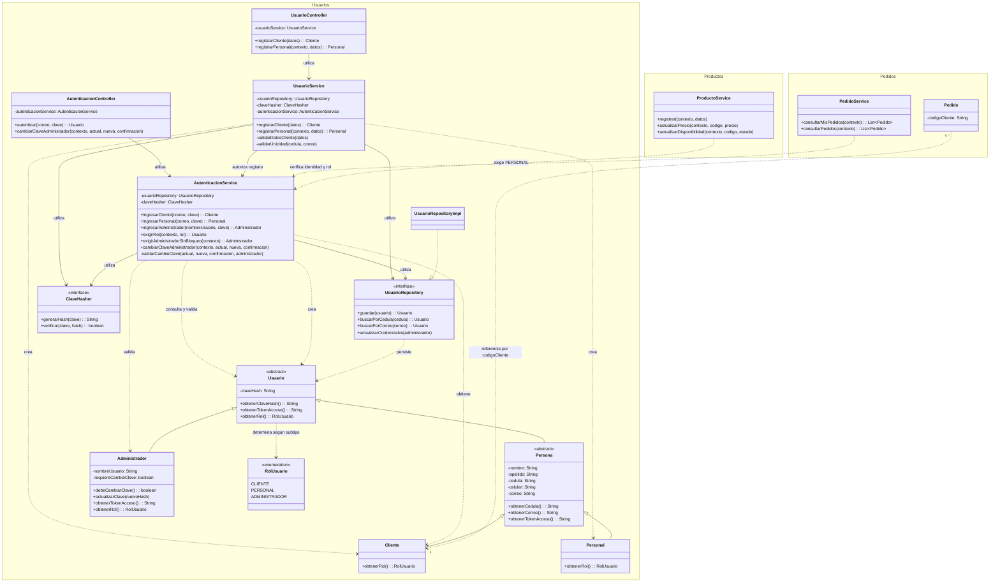

# DCU — Diagrama de Clases Módulo de Usuarios

## Versión

v1.0

## Trazabilidad

- Issue: #11
- Pull Request: #20

## Diagrama

## Observaciones

- **Arquitectura MVC:** `UsuarioView` representa los formularios y mensajes; los controladores reciben las solicitudes y delegan en servicios. El modelo comprende las entidades, las reglas de los servicios y los contratos de repositorio. La vista no accede directamente al repositorio; su diseño visual se definirá en el prototipo.
- **Entidades:** `Usuario` concentra la identidad de acceso y el hash de contraseña. `Persona` agrupa los datos comunes de clientes y personal, sin exigir esos datos al administrador. El identificador de acceso es el correo para clientes y personal, y el nombre de usuario predeterminado para el administrador. El rol se deriva del subtipo y no se acepta como un dato editable del registro.
- **Registro de clientes (RFU-01):** `UsuarioService` verifica todos los campos obligatorios, cédula y celular de exactamente 10 dígitos, correo del dominio institucional y ausencia de duplicados. El dominio debe configurarse según la institución. Una validación fallida impide guardar y permite a la vista indicar el motivo; un registro exitoso produce una confirmación.
- **Registro de personal (RFU-05):** el servicio exige un administrador autenticado, sin cambio de contraseña pendiente, antes de validar y guardar los datos. Se verifican los campos obligatorios, formatos y unicidad de cédula y correo. RFU-05 no define cómo se asigna la contraseña inicial del personal y alterna entre correo y correo institucional: ambas decisiones deben precisarse antes de implementar este flujo. El modelo contempla el hash necesario para RFU-04 sin inventar un mecanismo de entrega de credenciales.
- **Persistencia:** `UsuarioRepository` es el contrato para almacenamiento persistente de clientes, personal y credenciales del administrador. Su implementación debe garantizar la unicidad de cédula y correo incluso ante registros simultáneos. Las búsquedas pueden no encontrar un usuario; ese resultado se maneja en el servicio. No se fija una base de datos concreta.
- **Autenticación (RFU-02 y RFU-04):** `AutenticacionService` busca por identificador, verifica el hash y comprueba el rol esperado por el controlador. Usuario inexistente, contraseña incorrecta o rol incorrecto producen el mismo mensaje genérico. `ContrasenaHasher` permite usar una implementación de hash seguro para contraseñas; nunca se persisten contraseñas en texto plano ni se exponen hashes en la vista.
- **Contexto de acceso:** `ContextoAutenticado` representa la identidad validada por el servidor, no un código de usuario recibido libremente del formulario. Se recupera del mecanismo de sesión en cada solicitud. `exigirRol` consulta al usuario persistido y rechaza accesos sin autenticación, con rol incorrecto o con cambio obligatorio pendiente. `obtenerClienteAutenticado` aplica la misma comprobación para CLIENTE.
- **Administrador (RFU-06):** las credenciales iniciales se aprovisionan una sola vez durante la instalación, almacenando únicamente el hash y `requiereCambioContrasena = true`; reiniciar no las restablece. El primer acceso permite exclusivamente cambiar la contraseña. Esta operación verifica la identidad de administrador, la contraseña actual, la coincidencia de nueva y confirmación, y que la nueva sea distinta. Es la excepción al bloqueo por cambio pendiente. Solo después de validar todo se actualizan atómicamente el hash y la marca a `false`; ante cualquier error se conserva el estado anterior. Las credenciales iniciales se documentarán en el manual de instalación.
- **Pedidos propios (RFU-02):** `PedidoService.consultarMisPedidos` obtiene el cliente desde `AutenticacionService` y filtra por su código; no acepta un código de cliente arbitrario. La consulta individual debe aplicar la misma restricción. `consultarPedidos` exige PERSONAL y permite consultar los pedidos recibidos. La asociación muestra que un cliente puede tener cero o varios pedidos y cada pedido pertenece a un cliente.
- **Integración mínima:** las clases de Pedidos y Productos muestran únicamente las operaciones y datos relevantes para Usuarios. Productos conserva las firmas de su diagrama y obtiene el contexto de la sesión del servidor para exigir PERSONAL antes de registrar o editar. Los métodos de consulta de Pedidos son contratos propuestos para la integración. Usuarios no depende de los servicios ni repositorios de esos módulos (RNF-05).
- **Consistencia documental:** el criterio de RFU-04 sobre los pedidos propios del Cliente se trata como responsabilidad de RFU-02; no restringe al personal a pedidos propios. No se incluyen facturación, pagos ni funciones adicionales de edición o eliminación de usuarios.