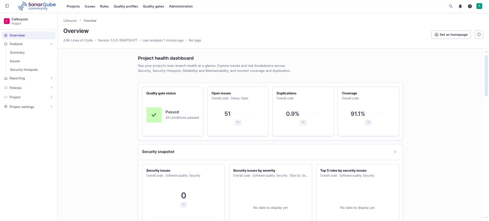

# Pruebas

**Versión:** v1.1  
**Autor:** Equipo 6  

El presente documento sirve como un índice de los casos de prueba del sistema informático para la gestión de pedidos de la cafetería universitaria. Su propósito es demostrar las funcionalidades y cualidades del sistema para facilitar la consulta del menú, el registro de pedidos anticipados y el seguimiento de estos hasta su entrega.

## Trazabilidad

- Issue: #38
- Pull Request: #43

## Tabla de Contenidos

- [Pruebas](#pruebas)
  - [Trazabilidad](#trazabilidad)
  - [Tabla de Contenidos](#tabla-de-contenidos)
  - [Casos de Prueba Funcionales](#casos-de-prueba-funcionales)
    - [Módulo de Usuarios](#módulo-de-usuarios)
    - [Módulo de Productos](#módulo-de-productos)
    - [Módulo de Pedidos](#módulo-de-pedidos)
  - [Casos de Prueba No Funcionales](#casos-de-prueba-no-funcionales)
  - [Análisis Estático con Sonarqube](#análisis-estático-con-sonarqube)

## Casos de Prueba Funcionales

### Módulo de Usuarios

* [CPU-01 v1.0 — Registro de usuario Cliente](./funcionales/usuarios/CPU-01.md)
* [CPU-02 v1.0 — Ingreso al sistema con usuario Cliente](./funcionales/usuarios/CPU-02.md)
* [CPU-03 v1.0 — Actualización de credenciales de Administrador](./funcionales/usuarios/CPU-03.md)
* [CPU-04 v1.0 — Registro de Personal por el Administrador](./funcionales/usuarios/CPU-04.md)
* [CPU-05 v1.0 — Ingreso al sistema con usuario Personal](./funcionales/usuarios/CPU-05.md)

### Módulo de Productos

* [CPM-01 v1.0 — Registro de productos en el menú](./funcionales/productos/CPM-01.md)
* [CPM-02 v1.0 — Consulta del menú por parte del Cliente](./funcionales/productos/CPM-02.md)
* [CPM-03 v1.0 — Actualización del precio de un producto del menú](./funcionales/productos/CPM-03.md)
* [CPM-04 v1.0 — Actualización de la disponibilidad de un producto del menú](./funcionales/productos/CPM-04.md)

### Módulo de Pedidos

* [CPP-01 v1.0 — Selección de productos y cantidades](./funcionales/pedidos/CPP-01.md)
* [CPP-02 v1.0 — Consulta del importe total antes de confirmar el pedido](./funcionales/pedidos/CPP-02.md)
* [CPP-03 v1.0 — Confirmación del pedido, código de retiro e inmutabilidad de precio](./funcionales/pedidos/CPP-03.md)
* [CPP-04 v1.0 — Consulta del estado del pedido por el Cliente](./funcionales/pedidos/CPP-04.md)
* [CPP-05 v1.0 — Consulta de pedidos por el Personal](./funcionales/pedidos/CPP-05.md)
* [CPP-06 v1.0 — Registro de avances y entrega de pedidos](./funcionales/pedidos/CPP-06.md)

## Casos de Prueba No Funcionales

* [CPNF-01 v1.0 — Tiempo de Respuesta de Menú](./nofuncionales/CPNF-01.md)
* [CPNF-02 v1.0 — Tiempo de Respuesta de Pedidos](./nofuncionales/CPNF-02.md)
* [CPNF-03 v1.0 — Responsividad en Escritorio y Dispositivos Móviles](./nofuncionales/CPNF-03.md)
* [CPNF-04 v1.0 — Cobertura de Pruebas](./nofuncionales/CPNF-04.md)

## Análisis Estático con Sonarqube

Además de las pruebas funcionales y no funcionales también se realizó el análisis de código estático con la herramienta Sonarqube

* [Reporte de Métricas exportado](./sonarqube/metrics.js)
* [Reporte de Problemas exportado](./sonarqube/issues.js)
* [Reporte Legible generado con IA](./sonarqube/REPORTE_SONARQUBE.md)