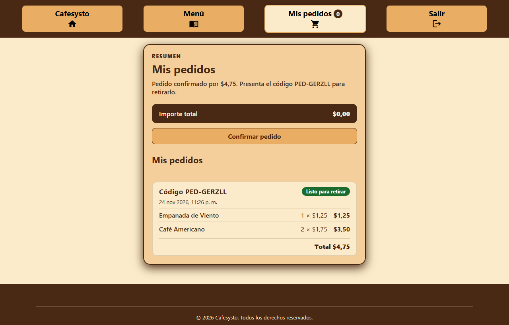

# CPP-04 — Consulta del estado del pedido por el Cliente

## Descripción

Comprobar que el Cliente pueda consultar en **Mis pedidos** el último estado registrado para sus pedidos confirmados conforme el Personal actualiza su preparación.

## Versión

v1.0

## Trazabilidad

**Historia de Usuario:** RFP-04
**Issue:** #36
**Pull Request:** Pendiente

**Criterio(s) de aceptación relacionado(s):**
- Al consultar uno de sus pedidos confirmados, el cliente ve el último estado registrado para ese pedido.

## Precondiciones

- El Cliente tiene un pedido confirmado (`PED-GERZLL`).
- El Personal ha avanzado el pedido de **Pendiente** a **En preparación** y luego a **Listo para retirar**.

## Datos de prueba

- Pedido consultado: `PED-GERZLL`.
- Estado esperado en pantalla: `Listo para retirar` (y `Entregado` al completarse el retiro).

## Procedimiento de prueba

1. Desde la sesión del Cliente, pulsar **Mis pedidos**.
2. Ubicar la tarjeta del pedido confirmado en el listado inferior.
3. Verificar la etiqueta de estado mostrada junto al código de retiro.

## Resultados esperados

La tarjeta del pedido muestra el estado actualizado **Listo para retirar** (y posteriormente **Entregado** tras registrarse la entrega).

## EJECUCIONES DEL CASO DE PRUEBA

### Ejecución 1

**Fecha:** 2026-11-24  
**Responsable:** Bryan Ayala

#### Resultados obtenidos

Al consultar **Mis pedidos**, la tarjeta de `PED-GERZLL` mostró el estado `Listo para retirar` sin necesidad de recargar la página (y cambió a `Entregado` una vez realizada la entrega).

#### Estado

- [x] Aprobado
- [ ] Reprobado

#### Capturas o evidencias

---

## Observaciones

- Ninguna.