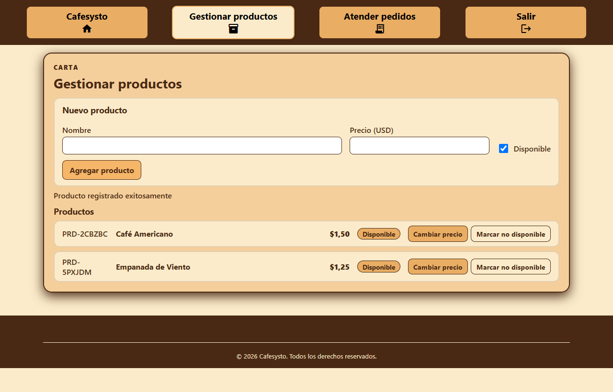
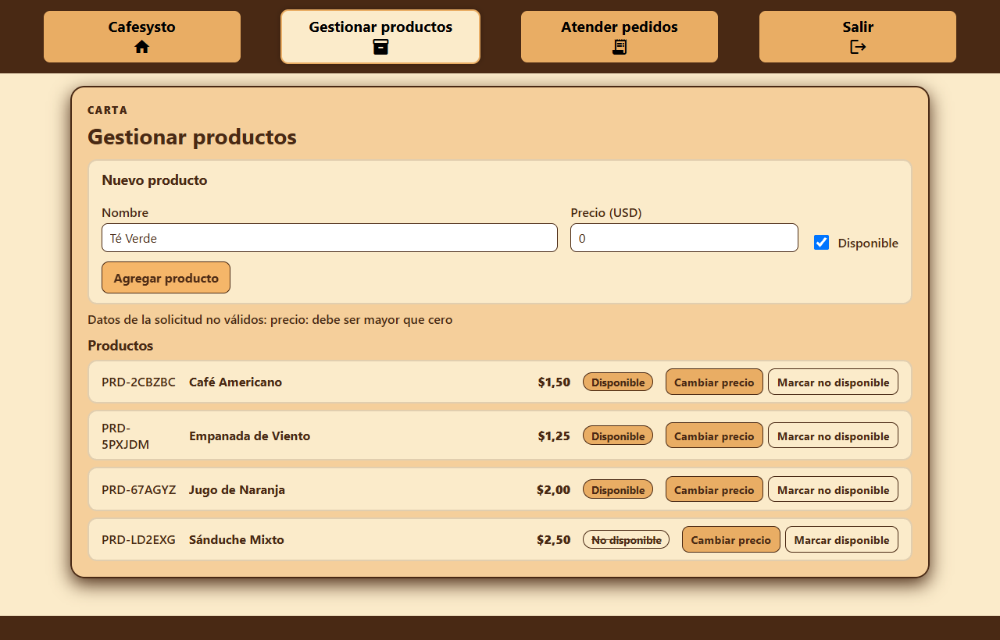

# CPM-01 — Registro de productos en el menú

## Descripción

Comprobar que el Personal pueda registrar nuevos productos indicando nombre, precio mayor a cero y estado de disponibilidad, y que el sistema rechace nombres duplicados y precios menores o iguales a cero.

## Versión

v1.0

## Trazabilidad

- Historia de Usuario: RFM-02
- Issue: #35
- Pull Request: #40

**Criterio(s) de aceptación relacionado(s):**

- El sistema permite añadir el nombre, el precio y el estado de un producto.
- El precio de un producto debe ser un número mayor a 0.
- Un producto solo puede tener estado "Disponible" o "No disponible".
- El sistema no permite registrar dos productos con el mismo nombre.
- Si el producto se ha registrado correctamente, el sistema muestra un mensaje de éxito y el producto aparece en el menú.

## Precondiciones

- El usuario ha iniciado sesión con rol **Personal** y se encuentra en **Gestionar productos**.
- Ya existe registrado el producto `Café Americano` (`$1,50`, Disponible).

## Datos de prueba

- **Ejecución 1 (registro válido):** Nombre `Empanada de Viento`, Precio (USD) `1.25`, Disponible marcado.
- **Ejecución 2 (nombre duplicado):** Nombre `Café Americano`, Precio (USD) `1.80`, Disponible marcado.
- **Ejecución 3 (precio igual a cero):** Nombre `Té Verde`, Precio (USD) `0`, Disponible marcado.

## Procedimiento de prueba

1. En **Gestionar productos**, llenar **Nombre**, **Precio (USD)** y la casilla **Disponible**.
2. Pulsar **Agregar producto**.
3. Verificar el mensaje de estado y la lista **Productos**.

## Resultados esperados

- Con datos válidos y nombre único, el producto se guarda con un código único (`PRD-XXXXXX`) y se muestra `Producto registrado exitosamente`.
- Si el nombre ya existe, se rechaza la creación informando la duplicación.
- Si el precio es `0` o menor, se rechaza la creación indicando que el precio debe ser mayor que cero.

## EJECUCIONES DEL CASO DE PRUEBA

### Ejecución 1

**Fecha:** 2026-11-24  
**Responsable:** Juan Chugá

#### Resultados obtenidos

Al registrar `Empanada de Viento` con precio `$1,25` y estado Disponible, el sistema le asignó el código `PRD-5PXJDM`, lo mostró en la lista de productos y desplegó `Producto registrado exitosamente`.

#### Estado

- [x] Aprobado
- [ ] Reprobado

#### Capturas o evidencias

---

### Ejecución 2

**Fecha:** 2026-11-24  
**Responsable:** Juan Chugá

#### Resultados obtenidos

Al intentar registrar nuevamente `Café Americano`, el sistema impidió la creación y mostró: `Ya existe un producto con ese nombre`.

#### Estado

- [x] Aprobado
- [ ] Reprobado

#### Capturas o evidencias

---

### Ejecución 3

**Fecha:** 2026-11-24  
**Responsable:** Juan Chugá

#### Resultados obtenidos

Al intentar registrar `Té Verde` con precio `0`, el sistema rechazó la solicitud y mostró: `Datos de la solicitud no válidos: precio: debe ser mayor que cero`.

#### Estado

- [x] Aprobado
- [ ] Reprobado

#### Capturas o evidencias

---

## Observaciones

- Ninguna.