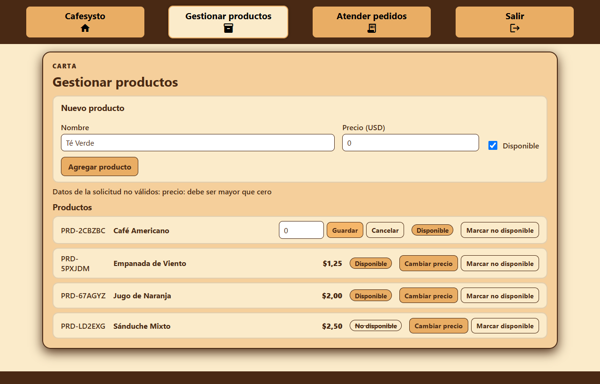
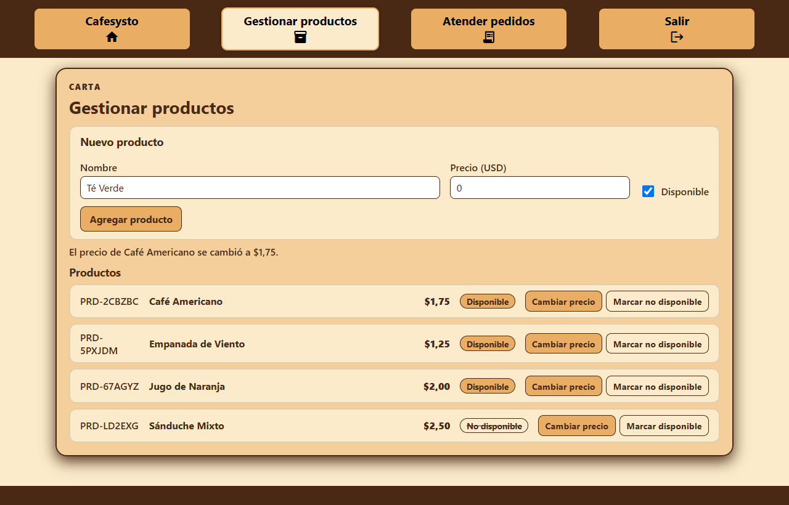
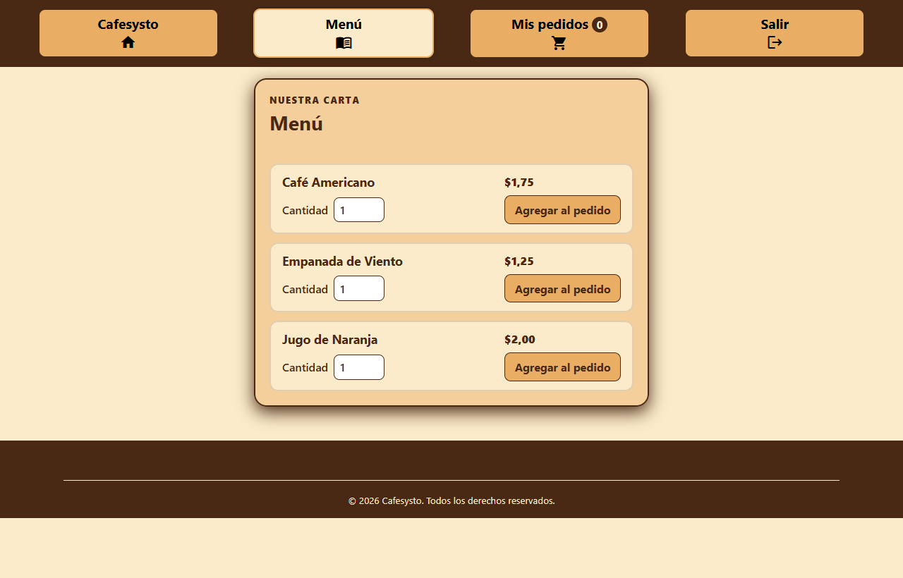

# CPM-03 — Actualización del precio de un producto del menú

## Descripción

Comprobar que el Personal pueda editar el precio de un producto existente solo con valores mayores a cero, rechazando precios inválidos y reflejando el cambio en el menú del cliente.

## Versión

v1.0

## Trazabilidad

**Historia de Usuario:** RFM-03-1
**Issue:** #35
**Pull Request:** Pendiente

**Criterio(s) de aceptación relacionado(s):**
- El sistema permite seleccionar un producto existente del menú para su edición.
- El sistema permite editar el precio del producto.
- El personal solo puede cambiar el precio a un valor numérico mayor a 0.
- Si el producto se ha actualizado correctamente, el sistema muestra un mensaje de éxito y los cambios se ven reflejados en el menú que ven los clientes.

## Precondiciones

- El Personal ha iniciado sesión y se encuentra en **Gestionar productos**.
- Existe el producto `Café Americano` (`PRD-2CBZBC`) con precio actual `$1,50`.

## Datos de prueba

- **Ejecución 1 (precio inválido):** Producto `Café Americano`, nuevo precio `0`.
- **Ejecución 2 (precio válido):** Producto `Café Americano`, nuevo precio `1.75`.

## Procedimiento de prueba

1. En **Gestionar productos**, pulsar **Cambiar precio** en `Café Americano`.
2. Ingresar el nuevo precio y pulsar **Guardar**.
3. Comprobar el mensaje de validación o confirmación en el panel de Personal.
4. En el caso válido, verificar el precio actualizado en la pestaña **Menú** del Cliente.

## Resultados esperados

- Al ingresar `0`, el sistema rechaza la edición y conserva el precio anterior (`$1,50`).
- Al ingresar `1.75`, el sistema guarda el cambio, informa la actualización y muestra `$1,75` en el menú del cliente.

## EJECUCIONES DEL CASO DE PRUEBA

### Ejecución 1

**Fecha:** 2026-11-24  
**Responsable:** Juan Chugá

#### Resultados obtenidos

Al ingresar `0` y pulsar **Guardar**, el sistema rechazó la modificación y mostró: `Datos de la solicitud no válidos: precio: debe ser mayor que cero`.

#### Estado

- [x] Aprobado
- [ ] Reprobado

#### Capturas o evidencias

---

### Ejecución 2

**Fecha:** 2026-11-24  
**Responsable:** Juan Chugá

#### Resultados obtenidos

Al ingresar `1.75` y pulsar **Guardar**, el sistema mostró `El precio de Café Americano se cambió a $1,75.` y el menú del cliente actualizó el precio a `$1,75` manteniendo intactos el código `PRD-2CBZBC` y el nombre del producto.

#### Estado

- [x] Aprobado
- [ ] Reprobado

#### Capturas o evidencias

---

## Observaciones

- Ninguna.