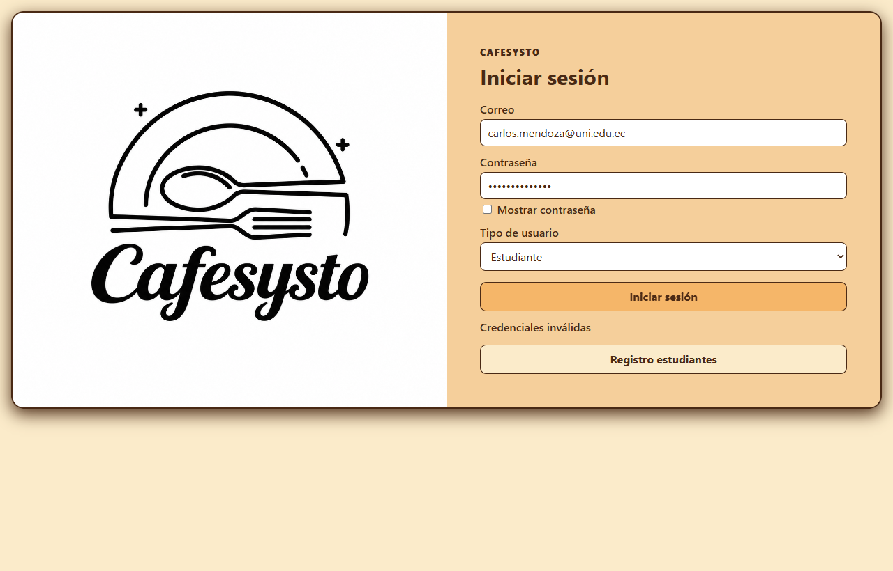
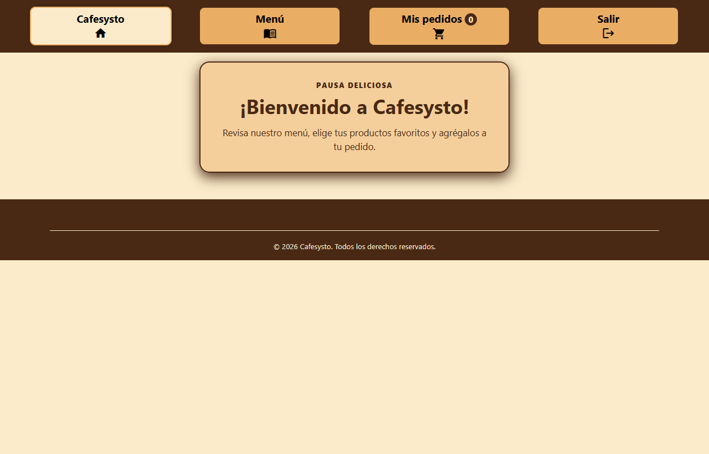

# CPU-02 — Ingreso al sistema con usuario Cliente

## Descripción

Comprobar que un Cliente registrado pueda iniciar sesión seleccionando **Estudiante** en **Tipo de usuario**, y que ante credenciales incorrectas el sistema muestre un mensaje de error genérico sin revelar qué dato falló.

## Versión

v1.0

## Trazabilidad

**Historia de Usuario:** RFU-02
**Issue:** #34
**Pull Request:** Pendiente

**Criterio(s) de aceptación relacionado(s):**
- El sistema solicita las credenciales del Cliente (correo institucional y contraseña).
- Si las credenciales son correctas, el sistema permite el acceso.
- Si las credenciales son incorrectas o el usuario no existe, el sistema muestra un mensaje de error genérico sin revelar cuál dato falló.

## Precondiciones

- Existe un usuario Cliente registrado con correo `carlos.mendoza@uni.edu.ec` y contraseña `Cliente123!`.
- El usuario se encuentra en la vista **Iniciar sesión**.

## Datos de prueba

- **Ejecución 1 (contraseña incorrecta):** Correo `carlos.mendoza@uni.edu.ec`, Contraseña `ClaveErronea99`, Tipo de usuario `Estudiante`.
- **Ejecución 2 (credenciales válidas):** Correo `carlos.mendoza@uni.edu.ec`, Contraseña `Cliente123!`, Tipo de usuario `Estudiante`.

## Procedimiento de prueba

1. Ingresar el correo institucional y la contraseña en el formulario de inicio de sesión.
2. Verificar que **Tipo de usuario** esté en **Estudiante**.
3. Pulsar **Iniciar sesión**.
4. Observar el mensaje de error o la redirección al panel del Cliente.

## Resultados esperados

- Con una contraseña incorrecta, el sistema bloquea el acceso y muestra `Credenciales inválidas`.
- Con credenciales válidas, el sistema redirige al panel principal del Cliente con acceso a **Menú** y **Mis pedidos**.

## EJECUCIONES DEL CASO DE PRUEBA

### Ejecución 1

**Fecha:** 2026-11-24  
**Responsable:** Jorge Revelo

#### Resultados obtenidos

Al ingresar la contraseña incorrecta, el sistema rechazó el acceso y mostró el mensaje genérico `Credenciales inválidas`.

#### Estado

- [x] Aprobado
- [ ] Reprobado

#### Capturas o evidencias

---

### Ejecución 2

**Fecha:** 2026-11-24  
**Responsable:** Jorge Revelo

#### Resultados obtenidos

Al ingresar las credenciales válidas, el sistema autenticó al usuario y lo llevó a la pantalla de bienvenida del Cliente con las opciones **Cafesysto**, **Menú**, **Mis pedidos** y **Salir**.

#### Estado

- [x] Aprobado
- [ ] Reprobado

#### Capturas o evidencias

---

## Observaciones

- Ninguna.