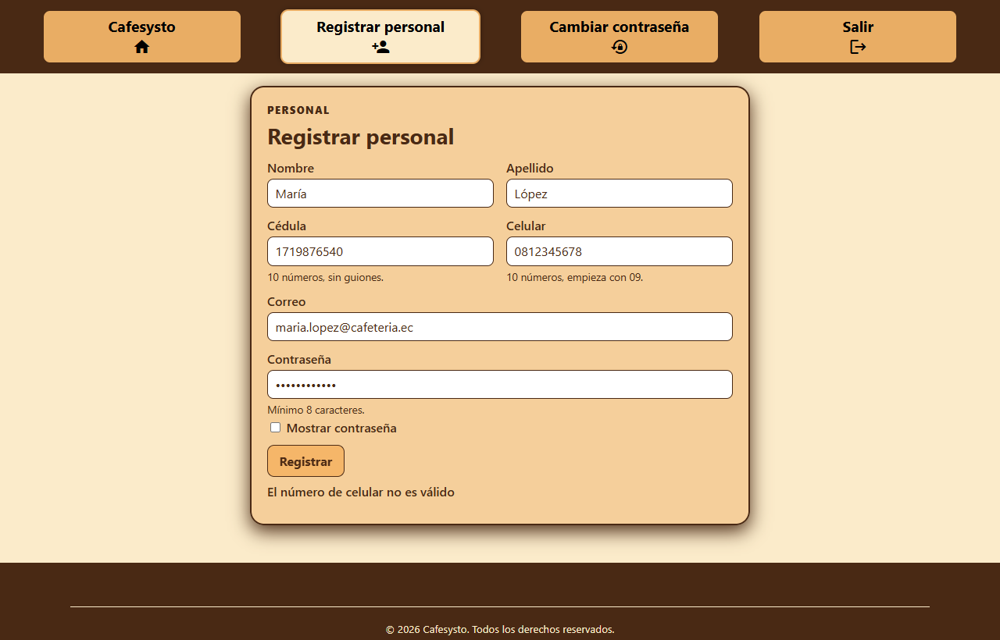
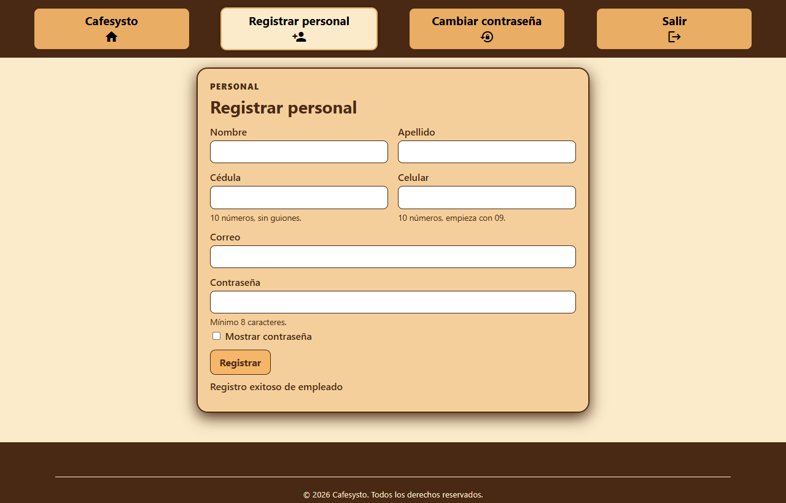

# CPU-04 — Registro de Personal por el Administrador

## Descripción

Comprobar que el Administrador pueda registrar nuevos miembros del Personal asignándoles su correo (de cualquier dominio válido) y contraseña inicial, validando el formato de cédula y celular antes de guardar.

## Versión

v1.0

## Trazabilidad

- Historia de Usuario: RFU-05
- Issue: #34
- Pull Request: #41

**Criterio(s) de aceptación relacionado(s):**

- El sistema solicita nombre, apellido, cédula, celular, correo y contraseña del Personal.
- El sistema valida el formato de la cédula, del celular y del correo.
- Los datos del personal se almacenan de forma persistente.
- El sistema muestra un mensaje de confirmación al finalizar el registro exitoso.
- Si los datos no cumplen las validaciones, el sistema informa el motivo y no crea el usuario.

## Precondiciones

- El Administrador ha iniciado sesión con su contraseña inicial ya actualizada y tiene habilitada la pestaña **Registrar personal**.
- La cédula `1719876540` y el correo `maria.lopez@cafeteria.ec` no existen previamente.

## Datos de prueba

- **Ejecución 1 (celular inválido):** Nombre `María`, Apellido `López`, Cédula `1719876540`, Celular `0812345678`, Correo `maria.lopez@cafeteria.ec`, Contraseña `Personal123!`.
- **Ejecución 2 (datos válidos):** Nombre `María`, Apellido `López`, Cédula `1719876540`, Celular `0991234567`, Correo `maria.lopez@cafeteria.ec`, Contraseña `Personal123!`.

## Procedimiento de prueba

1. En el panel de Administrador, pulsar **Registrar personal**.
2. Completar **Nombre**, **Apellido**, **Cédula**, **Celular**, **Correo** y **Contraseña**.
3. Pulsar **Registrar** y revisar el mensaje de estado.

## Resultados esperados

- Con un número celular que no empiece con `09`, el sistema impide el registro e informa el error.
- Con datos válidos, el sistema registra al miembro del Personal y confirma la creación.

## EJECUCIONES DEL CASO DE PRUEBA

### Ejecución 1

**Fecha:** 2026-11-24  
**Responsable:** Jorge Revelo

#### Resultados obtenidos

Al ingresar el celular `0812345678`, el sistema detuvo el registro y mostró el mensaje: `El número de celular no es válido`.

#### Estado

- [x] Aprobado
- [ ] Reprobado

#### Capturas o evidencias

---

### Ejecución 2

**Fecha:** 2026-11-24  
**Responsable:** Jorge Revelo

#### Resultados obtenidos

Al corregir el celular a `0991234567` y pulsar **Registrar**, el sistema creó el empleado y mostró el mensaje: `Registro exitoso de empleado`.

#### Estado

- [x] Aprobado
- [ ] Reprobado

#### Capturas o evidencias

---

## Observaciones

- El registro de Personal permite cualquier correo electrónico válido y la contraseña inicial la define el Administrador.