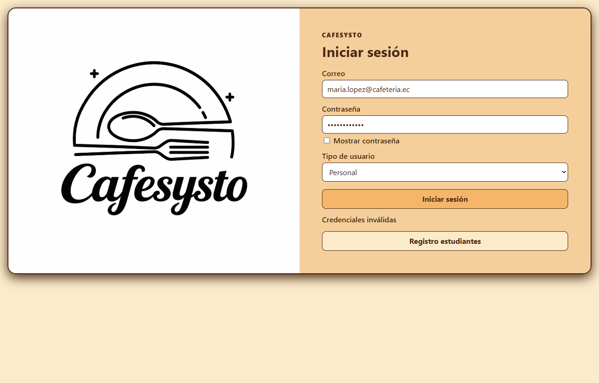
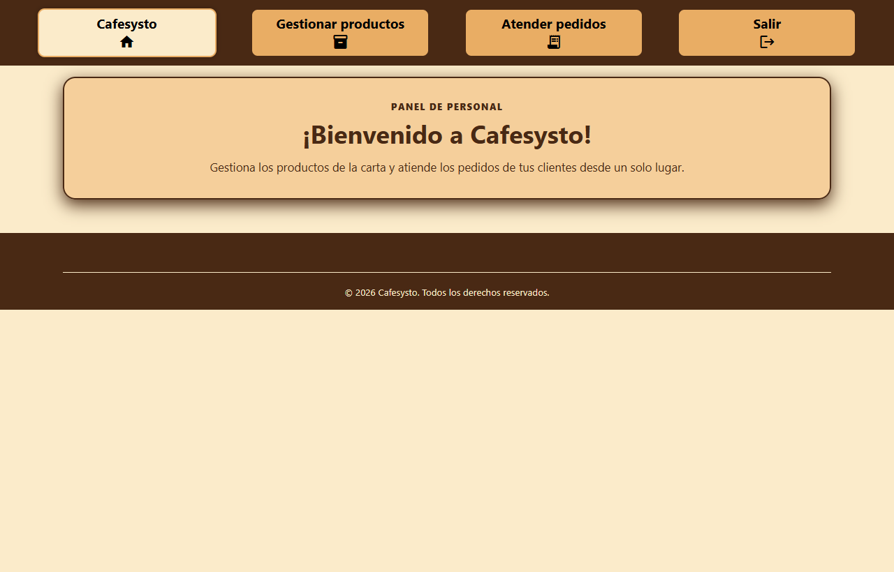

# CPU-05 — Ingreso al sistema con usuario Personal

## Descripción

Comprobar que un miembro del Personal registrado pueda iniciar sesión seleccionando **Personal** en **Tipo de usuario**, y que ante credenciales erróneas se muestre un mensaje de error genérico.

## Versión

v1.0

## Trazabilidad

**Historia de Usuario:** RFU-04
**Issue:** #34
**Pull Request:** Pendiente

**Criterio(s) de aceptación relacionado(s):**
- El sistema solicita las credenciales del Personal (correo y contraseña).
- Si las credenciales son correctas, el sistema permite el acceso.
- Si las credenciales son incorrectas o el usuario no existe, el sistema muestra un mensaje de error genérico sin revelar cuál dato falló.

## Precondiciones

- Existe un usuario Personal registrado con correo `maria.lopez@cafeteria.ec` y contraseña `Personal123!`.
- El usuario se encuentra en la pantalla de inicio de sesión.

## Datos de prueba

- **Ejecución 1 (contraseña incorrecta):** Correo `maria.lopez@cafeteria.ec`, Contraseña `ClaveMala123`, Tipo de usuario `Personal`.
- **Ejecución 2 (credenciales válidas):** Correo `maria.lopez@cafeteria.ec`, Contraseña `Personal123!`, Tipo de usuario `Personal`.

## Procedimiento de prueba

1. Ingresar el correo y la contraseña en la pantalla de inicio de sesión.
2. Seleccionar **Personal** en **Tipo de usuario**.
3. Pulsar **Iniciar sesión**.
4. Comprobar el mensaje de rechazo o la apertura del panel de Personal.

## Resultados esperados

- Ante una contraseña incorrecta, el sistema muestra `Credenciales inválidas`.
- Ante credenciales válidas, el sistema abre el panel de Personal con acceso a **Gestionar productos** y **Atender pedidos**.

## EJECUCIONES DEL CASO DE PRUEBA

### Ejecución 1

**Fecha:** 2026-11-24  
**Responsable:** Jorge Revelo

#### Resultados obtenidos

Al ingresar la contraseña incorrecta, el sistema negó el acceso y mostró el mensaje genérico `Credenciales inválidas`.

#### Estado

- [x] Aprobado
- [ ] Reprobado

#### Capturas o evidencias

---

### Ejecución 2

**Fecha:** 2026-11-24  
**Responsable:** Jorge Revelo

#### Resultados obtenidos

Al ingresar las credenciales correctas con rol **Personal**, el sistema mostró la pantalla de bienvenida con acceso a **Gestionar productos** y **Atender pedidos**.

#### Estado

- [x] Aprobado
- [ ] Reprobado

#### Capturas o evidencias

---

## Observaciones

- Ninguna.