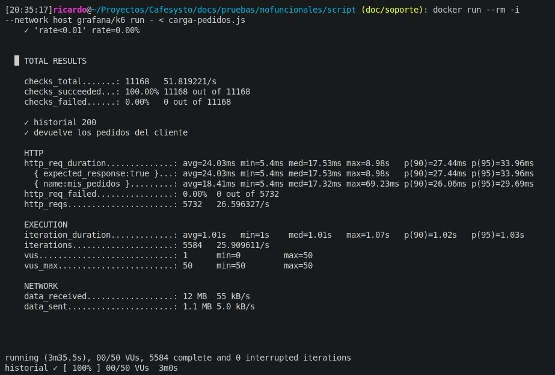
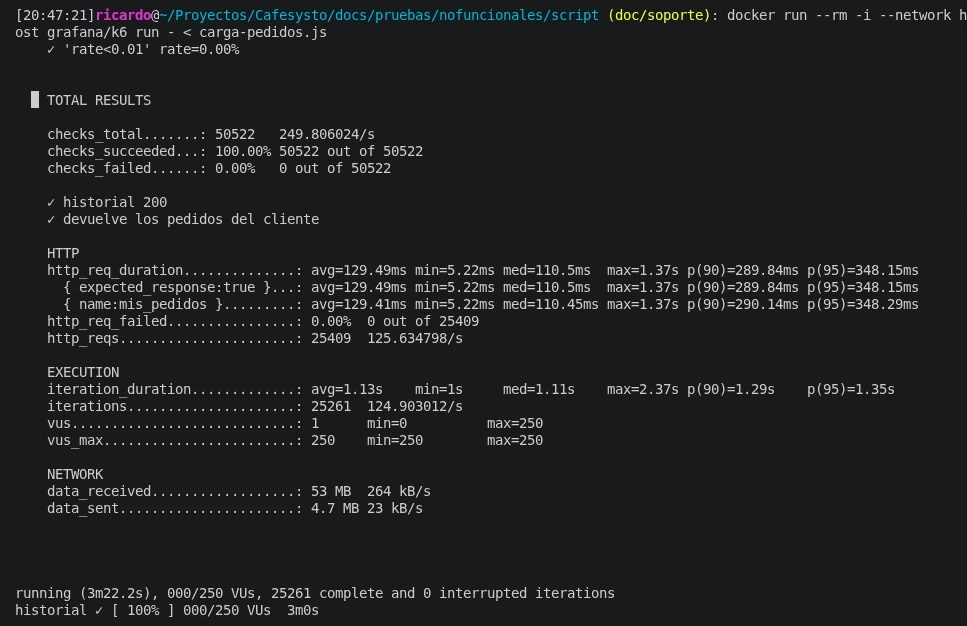
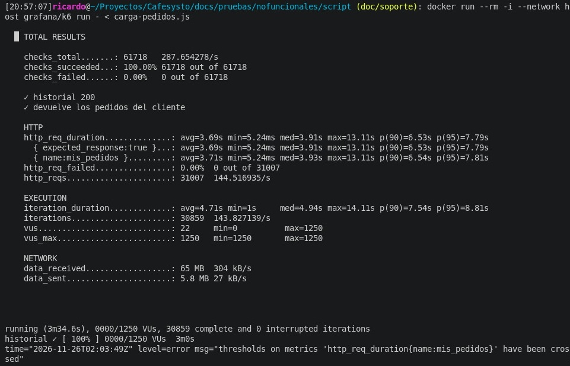

# CPNF-02 — Tiempo de Respuesta de Pedidos

## Descripción

| Campo | Descripción |
|---|---|
| **Tipo de prueba** | Carga |
| **Herramienta** | Grafana K6 |
| **Componente evaluado** | Endpoint /api/pedidos/mis-pedidos |
| **Objetivo** | Medir el tiempo de respuesta de consultas a los pedidos |

## Versión

v1.0

## Trazabilidad

- Requisito no funcional: RNF-02
- Issue: #37
- Pull Request: #42

**Criterio(s) de aceptación relacionado(s):**

- Tiempo transcurrido desde la solicitud de información del pedido hasta que la información se encuentre disponible en la interfaz menor a 2 segundos

## Procedimiento de prueba

### Preparación

1. Se creó el script [`carga-pedidos.js`](./script/carga-pedidos.js)
2. Se creó y ejecutó un contenedor PostgreSQL para la base de datos

    ```powershell
    docker run -d --name cafesysto-db -e POSTGRES_PASSWORD=postgres -p 5432:5432 postgres:18-alpine
    ```

3. En el directorio [`code`](../../../code/) se creó un archivo .env con las variables de entorno necesarias

    ```bash
    DB_URL=jdbc:postgresql://localhost:5432/cafesysto_db?stringtype=unspecified
    DB_USER=postgres
    DB_PASSWORD=postgres
    CAFESYSTO_CORREO_DOMINIO=uni.edu.ec

    CAFESYSTO_ADMIN_USUARIO=admin@administracion.${CAFESYSTO_CORREO_DOMINIO}
    CAFESYSTO_ADMIN_CLAVE=admin123
    ```

### Ejecución

1. Se creó una base de datos vacía

    ```powershell
    docker exec -i cafesysto-db psql -U postgres -c "CREATE DATABASE cafesysto_db ENCODING 'UTF8' TEMPLATE template0;"
    ```

2. Se modificó los parámetros de carga base y carga pico del script [`carga-pedidos.js`](./script/carga-pedidos.js)
3. Se ejecutó la aplicación desde el directorio [`code`](../../../code/)

    ```powershell
    mvn spring-boot:run
    ```

4. Se creó y ejecutó un contenedor de K6 desde el directorio [`script`](./script/) con el script [`carga-pedidos.js`](./script/carga-pedidos.js)

    ```powershell
    docker run --rm -i --network host grafana/k6 run - < carga.js
    ```

5. Se esperó a que termine la evaluación y se genere el reporte
6. Se detuvo la aplicación
7. Se borró la base de datos

    ```powershell
    docker exec -i cafesysto-db psql -U postgres -c "DROP DATABASE cafesysto_db;"
    ```

## Ejecuciones del Caso de Prueba

### Ejecución 1

**Fecha:** 2026-11-25  
**Responsable:** Ricardo Garzón

#### Parámetros

- **Carga Base:** 10 consultas simultáneas
- **Carga Pico:** 50 consultas simultáneas

#### Resultados obtenidos

Con unas 11168 peticiones en total se determinó que el 95% de las consultas demoraban menos de 33.96 milisegundos en concretarse, lo que se encuentra por debajo del umbral de 2 segundos. Además el 0% de las peticiones HTTP falló.

#### Estado

- [X] Aprobado
- [ ] Reprobado

#### Capturas o evidencias



---

### Ejecución 2

**Fecha:** 2026-11-25  
**Responsable:** Ricardo Garzón

#### Parámetros

- **Carga Base:** 50 consultas simultáneas
- **Carga Pico:** 250 consultas simultáneas

#### Resultados obtenidos

Con unas 50522 peticiones en total se determinó que el 95% de las consultas demoraban menos de 348.15 milisegundos en concretarse, lo que se encuentra por debajo del umbral de 2 segundos. Además el 0% de las peticiones HTTP falló.

#### Estado

- [X] Aprobado
- [ ] Reprobado

#### Capturas o evidencias



---

### Ejecución 3

**Fecha:** 2026-11-25  
**Responsable:** Ricardo Garzón

#### Parámetros

- **Carga Base:** 250 consultas simultáneas
- **Carga Pico:** 1250 consultas simultáneas

#### Resultados obtenidos

Con unas 61718 peticiones en total se determinó que el 95% de las consultas demoraban menos de 7.79 segundos en concretarse, lo que se encuentra por encima del umbral de 2 segundos.

#### Estado

- [ ] Aprobado
- [X] Reprobado

#### Capturas o evidencias



---

## Observaciones

- El tiempo de respuesta del menú menor a 2 segundos está garantizado con al menos una carga base de 50 consultas simultáneas y una carga pico de 250 consultas simultáneas.
- El tiempo de respuesta se puede mejorar implementando caching en el servidor ya que las consultas de pedidos son muy pesadas y muchas veces se repiten.