# CPNF-03 — Responsividad en Escritorio y Dispositivos Móviles

## Descripción

| Campo | Descripción |
|---|---|
| **Tipo de prueba** | Responsividad |
| **Herramienta** | Chrome DevTools |
| **Componente evaluado** | Interfaz |
| **Objetivo** | Verificar que la aplicación se adapte a la resolución de diferentes dispositivos |

## Versión

v1.0

## Trazabilidad

- Requisito no funcional: RNF-03, RNF-04
- Issue: #37
- Pull Request: Pendiente

**Criterio(s) de aceptación relacionado(s):**
- Funcionamiento del sistema en computadoras de escritorio.
- Funcionamiento del sistema en dispositivos móviles.

## Procedimiento de prueba

### Ejecución

1. Se ejecutó la aplicación
2. Se ingresó la aplicación desde un navegador Chromium
3. Se activó Chrome DevTools
4. Se exploró cada interfaz de usuario de la aplicación y emuló un dispositivo diferente para cada ejecución

## Ejecuciones del Caso de Prueba

### Ejecución 1

**Fecha:** 2026-11-26
**Responsable:** Ricardo Garzón

#### Parámetros

- **Dispositivo Emulado:** Ninguno (Escritorio)
- **Resolución:** 1200 x 620

#### Resultados obtenidos

Las interfaces de usuario para ingreso, cliente, personal y administrador se renderizaron correctamente, ningún elemento de la interfaz quedó oculto o cortado.

#### Estado

- [X] Aprobado
- [ ] Reprobado

#### Capturas o evidencias

Interfaz de usuario para ingreso

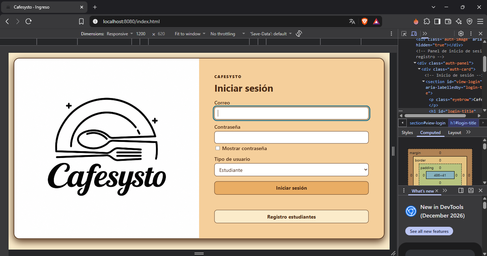

Interfaz de usuario para cliente

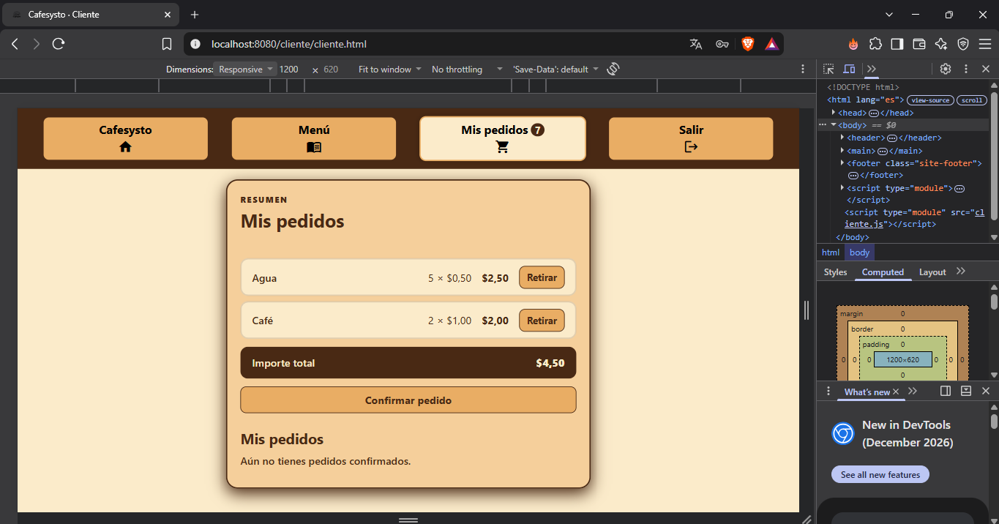

Interfaz de usuario para personal

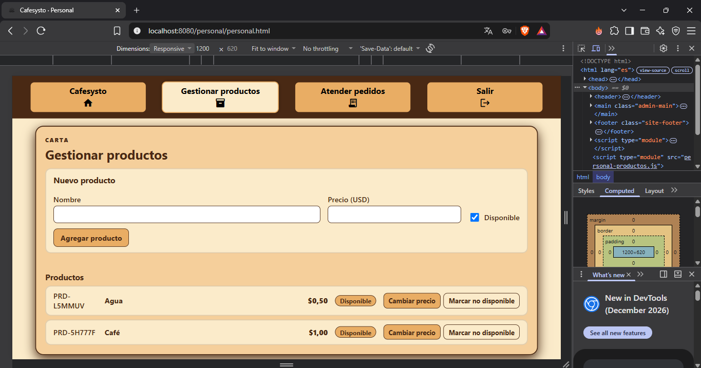

Interfaz de usuario para administrador

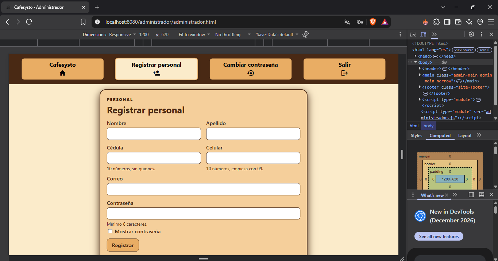

---

### Ejecución 2

**Fecha:** 2026-11-26
**Responsable:** Ricardo Garzón

#### Parámetros

- **Dispositivo Emulado:** Pixel 10
- **Resolución:** 412 x 924

#### Resultados obtenidos

Las interfaces de usuario para ingreso, cliente, personal y administrador se renderizaron correctamente, ningún elemento de la interfaz quedó oculto o cortado.

#### Estado

- [X] Aprobado
- [ ] Reprobado

#### Capturas o evidencias

Interfaz de usuario para ingreso

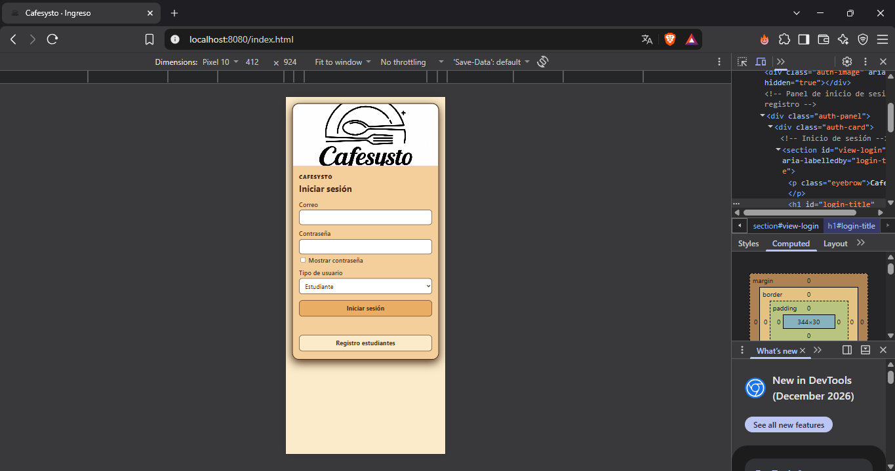

Interfaz de usuario para cliente

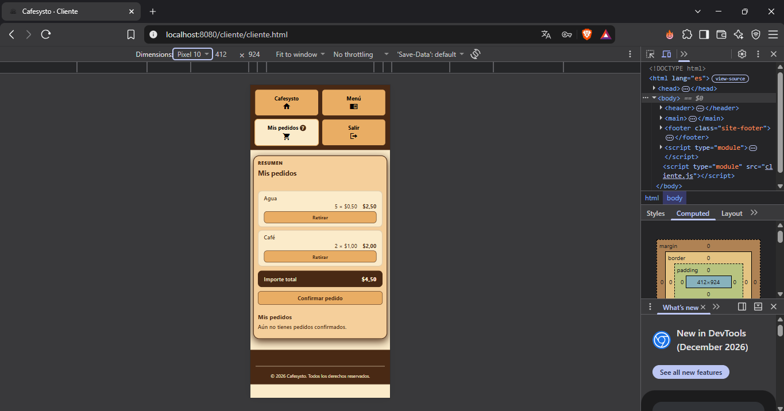

Interfaz de usuario para personal

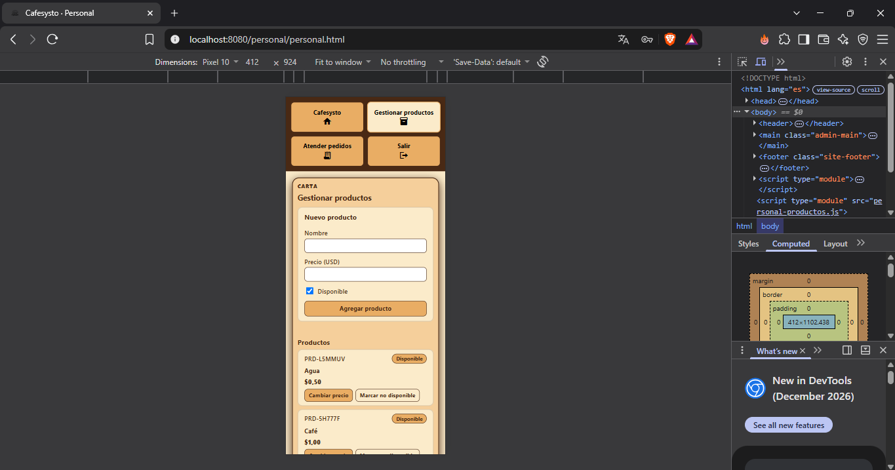

Interfaz de usuario para administrador

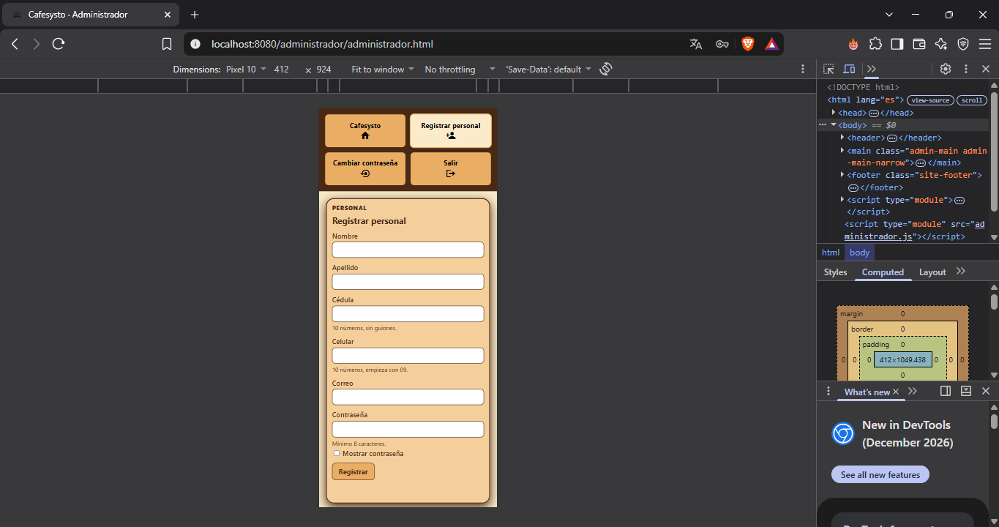

---

### Ejecución 3

**Fecha:** 2026-11-26
**Responsable:** Ricardo Garzón

#### Parámetros

- **Dispositivo Emulado:** iPad Pro 13
- **Resolución:** 1032 x 1376

#### Resultados obtenidos

Las interfaces de usuario para ingreso, cliente, personal y administrador se renderizaron correctamente, ningún elemento de la interfaz quedó oculto o cortado.

#### Estado

- [X] Aprobado
- [ ] Reprobado

#### Capturas o evidencias

Interfaz de usuario para ingreso

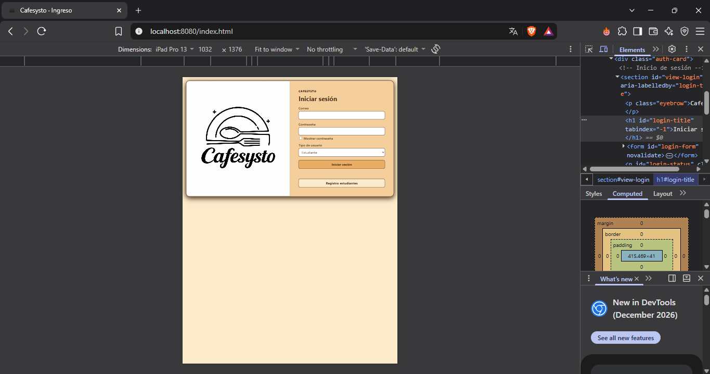

Interfaz de usuario para cliente

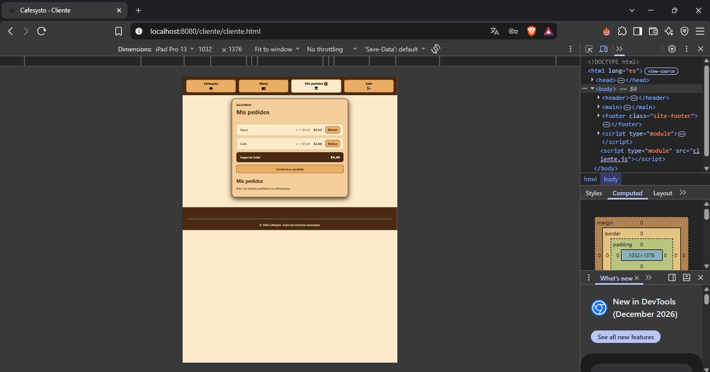

Interfaz de usuario para personal

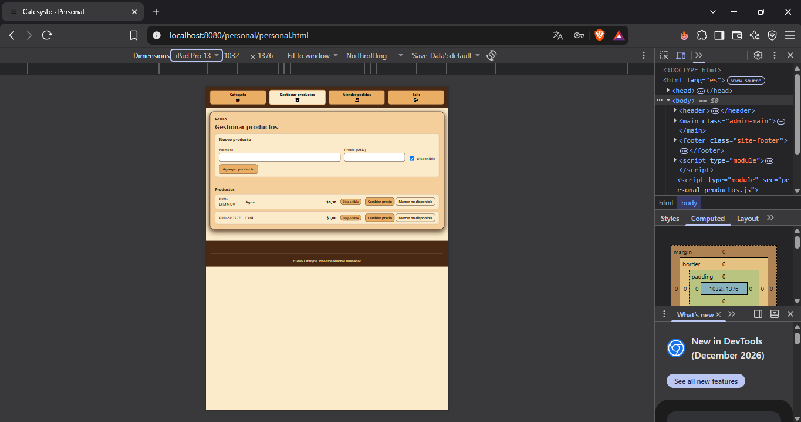

Interfaz de usuario para administrador

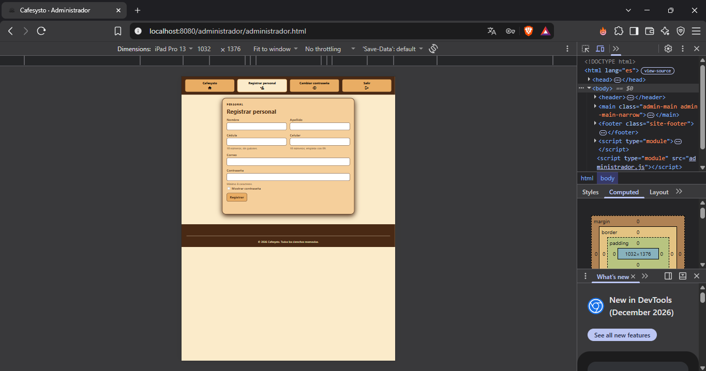

---

## Observaciones

- Ninguna