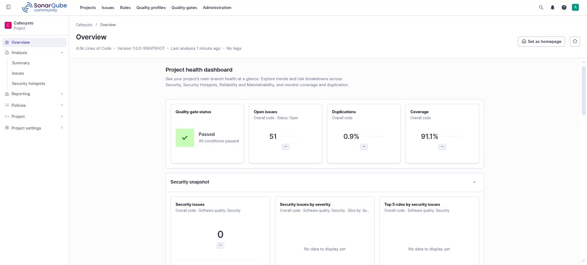
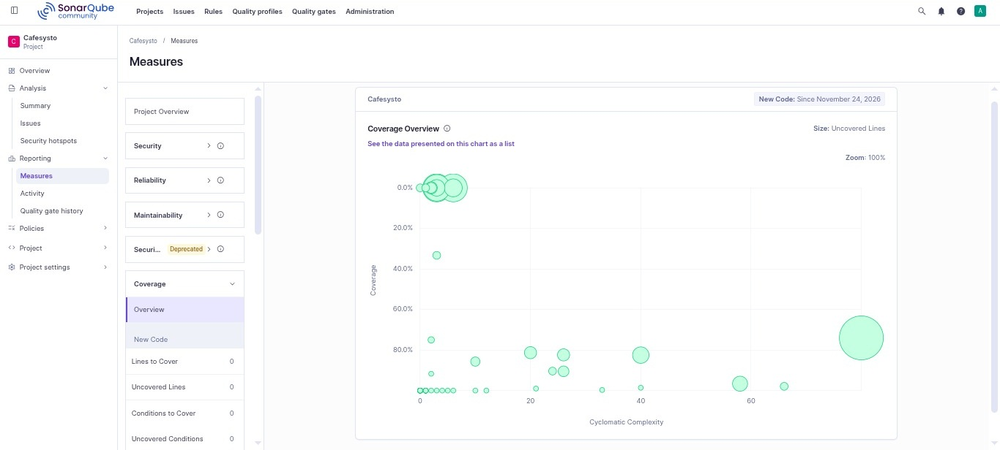

# CPNF-04 — Cobertura de Pruebas

## Descripción

| Campo | Descripción |
|---|---|
| **Tipo de prueba** | Análisis Estático |
| **Herramienta** | Sonarqube + Maven + JaCoCo + MojoHaus + NPM |
| **Componente evaluado** | Backend + Frontend |
| **Objetivo** | Determinar el porcentaje de cobertura de pruebas de código automatizadas tanto en backend como en frontend |

## Versión

v1.0

## Trazabilidad

- Requisito no funcional: RNF-06
- Issue: #37
- Pull Request: Pendiente

**Criterio(s) de aceptación relacionado(s):**
- Métrica *Line Coverage* igual o superior al 80 %

## Procedimiento de prueba

### Preparación

1. Se creó y ejecutó un contenedor de Sonarqube

```powershell
docker run -d --name sonarqube -p 9000:9000 -e SONAR_ES_BOOTSTRAP_CHECKS_DISABLE=true sonarqube:community
```

2. Se esperó a que Sonarqube entre en operación
3. Se ingresó a `http://localhost:9000` con las credenciales admin/admin
4. Se definió una contraseña de acceso a Sonarqube
5. Se creó un proyecto con nombre `Cafesysto`, llave `cafesysto` y opción `Follows the instance's default`
6. Se generó el token de Sonarqube y se guardó en la variable de entorno `SONAR_TOKEN` de la sesión actual de PowerShell.
7. En tipo de proyecto se eligió `Maven`
8. En perfil de calidad se eligió `Sonar way comprehensive`

Para definir el token en la sesión actual de PowerShell:

```powershell
$env:SONAR_TOKEN = "<token-generado-en-sonarqube>"
```

No guardar el token en el repositorio ni compartirlo.

### Ejecución

1. Desde la raíz del repositorio, se ingresó al directorio [`code`](../../../code/) en PowerShell:

   ```powershell
   Set-Location .\code
   ```

2. Se instalaron las dependencias de JavaScript desde [`code`](../../../code/):

   ```powershell
   npm.cmd ci
   ```

3. Se generó un reporte de cobertura de pruebas de JavaScript:

   ```powershell
   npm.cmd run coverage
   ```

4. Se ejecutó el análisis estático para SonarQube:

   ```powershell
   .\mvnw.cmd clean verify org.sonarsource.scanner.maven:sonar-maven-plugin:sonar `
     -Dsonar.projectKey=cafesysto `
     "-Dsonar.projectName=Cafesysto" `
     -Dsonar.host.url=http://localhost:9000 `
     "-Dsonar.token=$env:SONAR_TOKEN" `
     -Dsonar.sources=src/main `
     -Dsonar.tests=src/test `
     -Dsonar.javascript.lcov.reportPaths=coverage/lcov.info
   ```

5. Se ingresó a `http://localhost:9000` para observar el reporte generado

## Ejecuciones del Caso de Prueba

### Ejecución 1

**Fecha:** 2026-11-26
**Responsable:** Ricardo Garzón

#### Parámetros

- **Perfil de Calidad:** Sonar way comprehensive

#### Resultados obtenidos

El reporte de Sonarqube indica una cobertura de pruebas de código automatizadas del 91.1%, superando el umbral del 80% establecido como requisito.

#### Estado

- [X] Aprobado
- [ ] Reprobado

#### Capturas o evidencias

Reporte de métricas de Sonarqube



Gráfica de cobertura de pruebas vs complejidad ciclométrica



---

## Observaciones

- Ninguna.