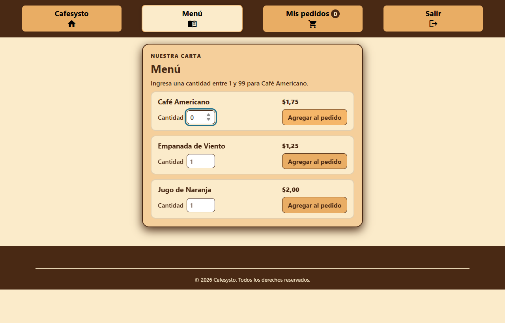
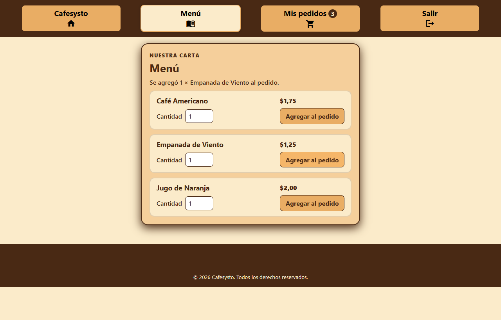

# CPP-01 — Selección de productos y cantidades

## Descripción

Comprobar que el Cliente pueda añadir uno o más productos disponibles con sus cantidades al pedido en curso, conservando los artículos previamente agregados y rechazando cantidades menores a 1.

## Trazabilidad

**Historia de Usuario:** RFP-01
**Issue:** #4 (Requisitos), #36 (Pruebas)
**Pull Request:** #7 (Requisitos), #32 (Implementación)

**Criterio(s) de aceptación relacionado(s):**
- Al seleccionar un producto disponible, este aparece en la selección del cliente.
- Si un producto está marcado como no disponible, el cliente no puede añadirlo a la selección.
- Al indicar la cantidad de un producto seleccionado, el sistema la muestra junto a ese producto.
- Al añadir otro producto, se conservan los productos ya seleccionados y sus cantidades.

## Precondiciones

- El Cliente ha iniciado sesión y accede a la pestaña **Menú**.
- Están disponibles `Café Americano` (`$1,75`), `Empanada de Viento` (`$1,25`) y `Jugo de Naranja` (`$2,00`); `Sánduche Mixto` está marcado como No disponible.

## Datos de prueba

- **Ejecución 1 (cantidad inválida):** Producto `Café Americano`, Cantidad `0`.
- **Ejecución 2 (selección múltiple válida):** `Café Americano` (cantidad `2`) y `Empanada de Viento` (cantidad `1`).

## Procedimiento de prueba

1. Abrir la pestaña **Menú** en el panel del Cliente.
2. Ingresar la cantidad en el campo **Cantidad** de `Café Americano` y pulsar **Agregar al pedido**.
3. En la ejecución válida, ingresar cantidad `1` en `Empanada de Viento` y pulsar **Agregar al pedido**.
4. Revisar el mensaje de estado y el contador junto a **Mis pedidos**.

## Resultados esperados

- Al ingresar cantidad `0`, el sistema rechaza la acción, informa el rango permitido (`1` a `99`) y no añade el producto.
- Al agregar ambos productos válidos, se conservan ambos en la selección y el contador de **Mis pedidos** marca `3`.

## EJECUCIONES DEL CASO DE PRUEBA

### Ejecución 1

**Fecha:** 2026-11-24  
**Responsable:** Bryan Ayala

#### Resultados obtenidos

Al escribir `0` en `Café Americano` y pulsar **Agregar al pedido**, el sistema rechazó la operación sin añadir el artículo y mostró el mensaje: `Ingresa una cantidad entre 1 y 99 para Café Americano.`.

#### Estado

- [x] Aprobado
- [ ] Reprobado

#### Capturas o evidencias

---

### Ejecución 2

**Fecha:** 2026-11-24  
**Responsable:** Bryan Ayala

#### Resultados obtenidos

Al añadir `2` unidades de `Café Americano` y `1` unidad de `Empanada de Viento`, el sistema mostró `Se agregó 1 × Empanada de Viento al pedido.` y actualizó el contador de **Mis pedidos** a `3`.

#### Estado

- [x] Aprobado
- [ ] Reprobado

#### Capturas o evidencias

---

## Observaciones

- El producto no disponible (`Sánduche Mixto`) no apareció en el menú, impidiendo añadirlo al pedido.
