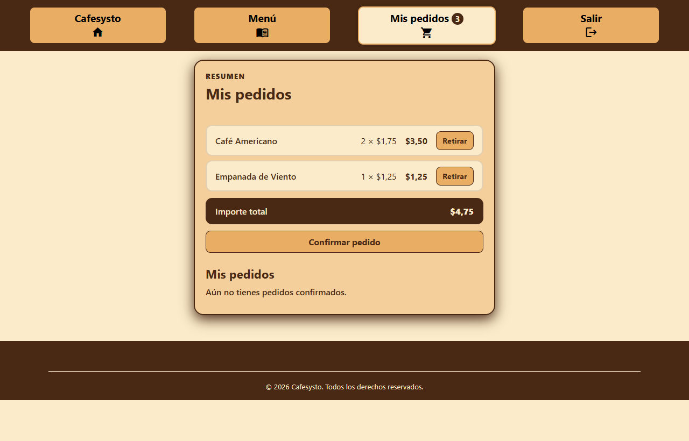

# CPP-02 — Consulta del importe total antes de confirmar el pedido

## Descripción

Comprobar que el Cliente pueda revisar los productos seleccionados, sus subtotales y el **Importe total** calculado con los precios vigentes antes de confirmar el pedido.

## Trazabilidad

**Historia de Usuario:** RFP-02
**Issue:** #36
**Pull Request:** Pendiente

**Criterio(s) de aceptación relacionado(s):**
- Al revisar una selección válida, el cliente ve el importe total antes de confirmar el pedido.
- El importe mostrado es la suma del precio vigente de cada producto seleccionado multiplicado por su cantidad.

## Precondiciones

- El Cliente tiene seleccionados `2 × Café Americano` (`$1,75` c/u) y `1 × Empanada de Viento` (`$1,25`) sin haber confirmado todavía el pedido.

## Datos de prueba

- `Café Americano`: `2 × $1,75 = $3,50`.
- `Empanada de Viento`: `1 × $1,25 = $1,25`.
- Importe total esperado: `$4,75`.

## Procedimiento de prueba

1. Pulsar la pestaña **Mis pedidos** en la barra superior.
2. Revisar cada producto listado, su cantidad, precio unitario, subtotal y el botón **Retirar**.
3. Comprobar el valor mostrado en **Importe total** y que **Confirmar pedido** esté habilitado.

## Resultados esperados

El sistema muestra el detalle de ambos productos y un **Importe total** de `$4,75` antes de registrar el pedido.

## EJECUCIONES DEL CASO DE PRUEBA

### Ejecución 1

**Fecha:** 2026-11-24  
**Responsable:** Bryan Ayala

#### Resultados obtenidos

Al abrir **Mis pedidos**, el sistema mostró `Café Americano` (`2 × $1,75`, subtotal `$3,50`), `Empanada de Viento` (`1 × $1,25`, subtotal `$1,25`) y el **Importe total** `$4,75`, sin haber creado aún el pedido.

#### Estado

- [x] Aprobado
- [ ] Reprobado

#### Capturas o evidencias

---

## Observaciones

- Ninguna.
