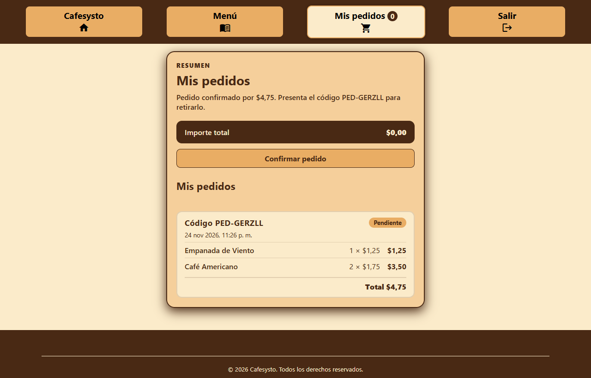

# CPP-03 — Confirmación del pedido, código de retiro e inmutabilidad de precio

## Descripción

Comprobar que al confirmar una selección válida el pedido se registre en estado **Pendiente** con un código único de retiro, y que un cambio posterior en el precio del menú no modifique el importe del pedido ya confirmado.

## Trazabilidad

**Historia de Usuario:** RFP-03
**Issue:** #4 (Requisitos), #36 (Pruebas)
**Pull Request:** #7 (Requisitos), #32 (Implementación)

**Criterio(s) de aceptación relacionado(s):**
- Al revisar el resumen, el pedido todavía no se registra.
- Al confirmar una selección válida, el pedido se registra en estado Pendiente.
- El cliente recibe el resumen del pedido y un código de retiro único.
- Si cambia el precio de un producto en el menú después de la confirmación, el pedido conserva el precio que se registró al confirmarlo.

## Precondiciones

- El Cliente está en **Mis pedidos** con una selección válida de `2 × Café Americano` (`$1,75`) y `1 × Empanada de Viento` (`$1,25`), por un total de `$4,75`.

## Datos de prueba

- **Ejecución 1 (confirmación):** Selección de `$4,75` confirmada mediante **Confirmar pedido**.
- **Ejecución 2 (cambio posterior de precio en el menú):** El Personal cambia el precio de `Café Americano` de `$1,75` a `$2,25` después de confirmar el pedido.

## Procedimiento de prueba

1. En **Mis pedidos**, pulsar **Confirmar pedido**.
2. Comprobar el mensaje con el código único (`PED-XXXXXX`), el vaciado de la selección en curso y la aparición de la tarjeta en estado **Pendiente**.
3. Desde una sesión de **Personal**, cambiar el precio de `Café Americano` a `2.25` en **Gestionar productos**.
4. Revisar nuevamente el historial del pedido confirmado en **Mis pedidos** del Cliente.

## Resultados esperados

- Al confirmar, el pedido se guarda con estado **Pendiente**, código único en formato `PED-XXXXXX` y total `$4,75`.
- Tras modificar el precio de `Café Americano` en el menú a `$2,25`, el pedido ya confirmado mantiene `$1,75` como precio unitario y `$4,75` como total.

## EJECUCIONES DEL CASO DE PRUEBA

### Ejecución 1

**Fecha:** 2026-11-24  
**Responsable:** Bryan Ayala

#### Resultados obtenidos

Al pulsar **Confirmar pedido**, el sistema mostró: `Pedido confirmado por $4,75. Presenta el código PED-GERZLL para retirarlo.`. El pedido apareció en el historial con estado `Pendiente`, detalle completo y total `$4,75`.

#### Estado

- [x] Aprobado
- [ ] Reprobado

#### Capturas o evidencias

---

### Ejecución 2

**Fecha:** 2026-11-24  
**Responsable:** Bryan Ayala

#### Resultados obtenidos

Después de que el Personal actualizó `Café Americano` a `$2,25` (`El precio de Café Americano se cambió a $2,25.`), el pedido confirmado `PED-GERZLL` en el historial del Cliente conservó `2 × $1,75` (`$3,50`) y `Total $4,75` sin alteración.

#### Estado

- [x] Aprobado
- [ ] Reprobado

#### Capturas o evidencias

---

## Observaciones

- Se verificó el cumplimiento de la regla de inmutabilidad de precios (`RN-NEG-04`).
