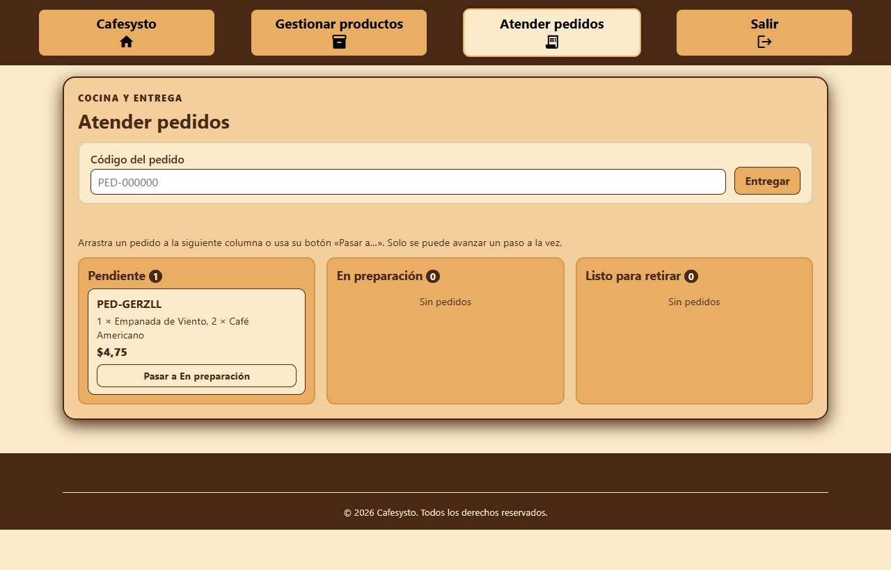

# CPP-05 — Consulta de pedidos por el Personal

## Descripción

Comprobar que el Personal pueda consultar los pedidos recibidos en el tablero de **Atender pedidos**, identificando los pedidos en estado **Pendiente** junto con su código de retiro, detalle de productos y monto total.

## Trazabilidad

**Historia de Usuario:** RFP-05-1
**Issue:** #4 (Requisitos), #36 (Pruebas)
**Pull Request:** #7 (Requisitos), #32 (Implementación)

**Criterio(s) de aceptación relacionado(s):**
- El personal puede consultar los pedidos e identificar cuáles están Pendientes.
- Al consultar un pedido, el personal puede ver el código de retiro asociado a ese pedido.

## Precondiciones

- Existe un pedido confirmado en estado **Pendiente** (`PED-GERZLL`).
- El usuario ha iniciado sesión con rol **Personal**.

## Datos de prueba

- Pedido esperado en columna **Pendiente**: `PED-GERZLL`, `2 × Café Americano, 1 × Empanada de Viento`, `$4,75`.

## Procedimiento de prueba

1. En el panel de Personal, pulsar **Atender pedidos**.
2. Revisar las columnas **Pendiente**, **En preparación** y **Listo para retirar**.
3. Verificar que el pedido aparezca en **Pendiente** con su código de retiro, productos e importe total.

## Resultados esperados

La columna **Pendiente** muestra contador `1` y presenta la tarjeta del pedido con su código de retiro, detalle de productos, importe `$4,75` y el botón **Pasar a En preparación**.

## EJECUCIONES DEL CASO DE PRUEBA

### Ejecución 1

**Fecha:** 2026-11-24  
**Responsable:** Bryan Ayala

#### Resultados obtenidos

Al ingresar a **Atender pedidos**, la columna **Pendiente** mostró `1` pedido correspondiente a `PED-GERZLL`, con el detalle `2 × Café Americano, 1 × Empanada de Viento` y total `$4,75`.

#### Estado

- [x] Aprobado
- [ ] Reprobado

#### Capturas o evidencias

---

## Observaciones

- Ninguna.
