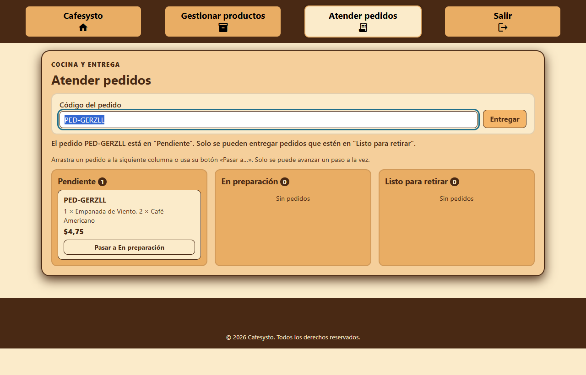
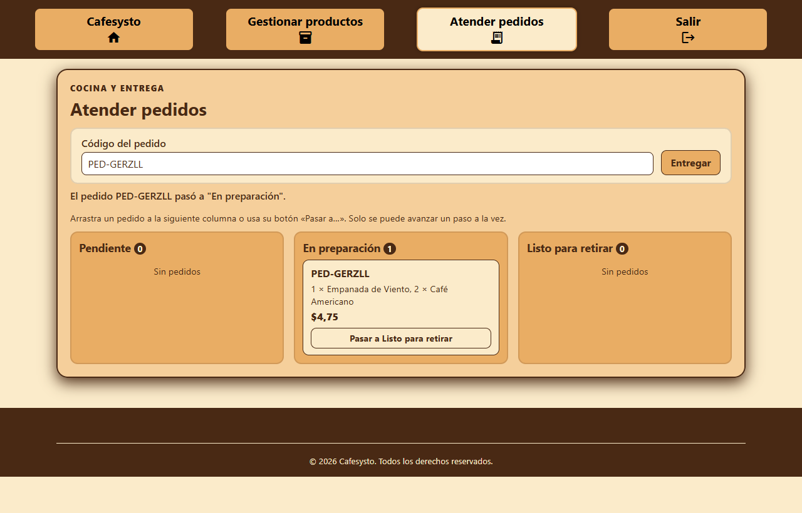
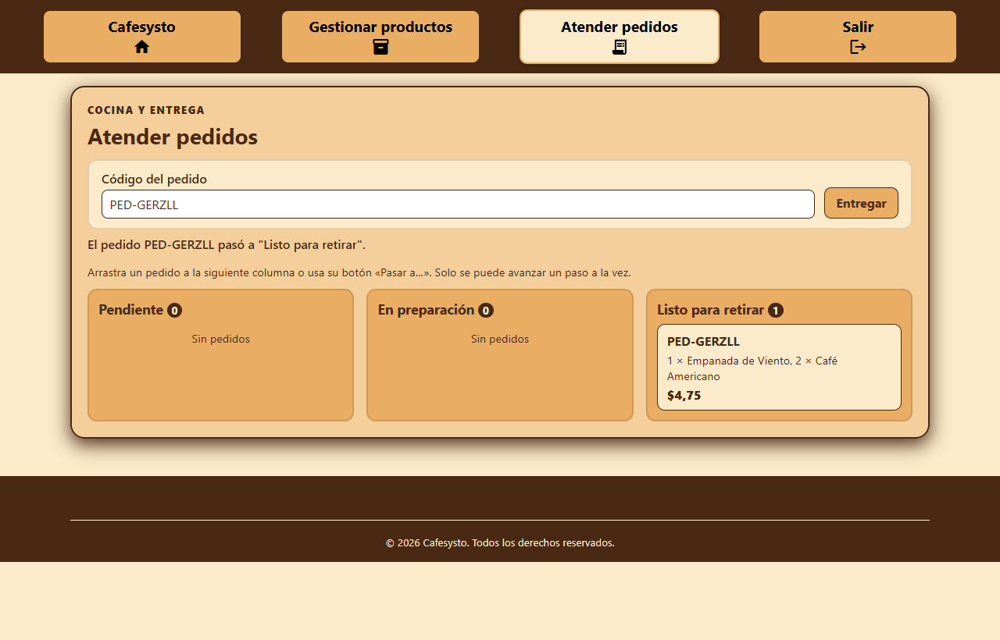
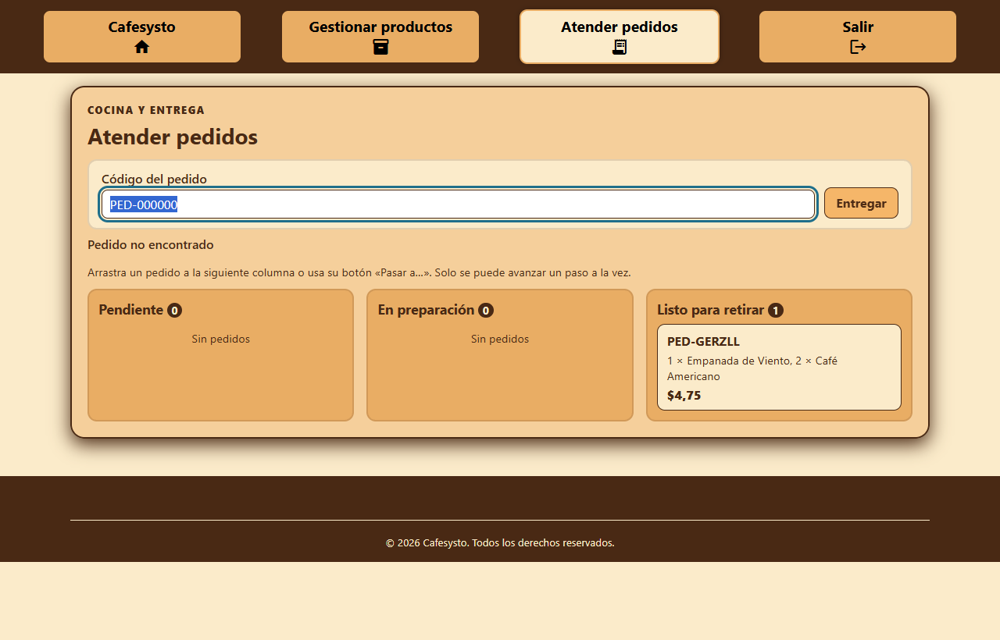
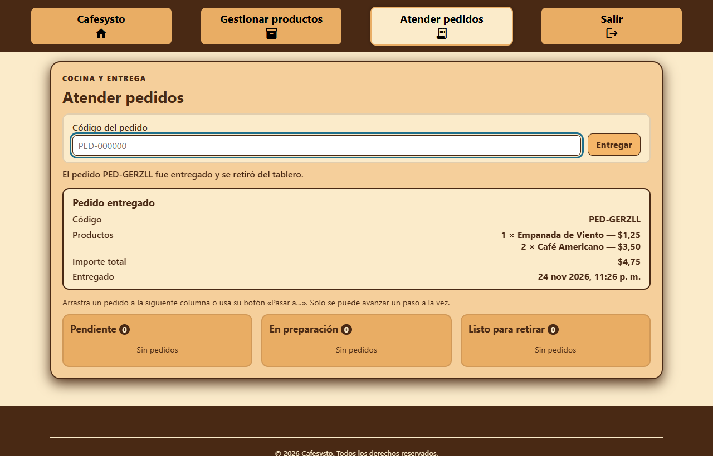

# CPP-06 — Registro de avances y entrega de pedidos

## Descripción

Comprobar que el Personal pueda avanzar un pedido únicamente en el orden **Pendiente → En preparación → Listo para retirar → Entregado**, y que el sistema impida entregar un pedido antes de estar listo o con un código de retiro incorrecto.

## Trazabilidad

**Historia de Usuario:** RFP-05-2
**Issue:** #4 (Requisitos), #36 (Pruebas)
**Pull Request:** #7 (Requisitos), #32 (Implementación)

**Criterio(s) de aceptación relacionado(s):**
- El personal puede tomar un pedido Pendiente y colocarlo a En preparación.
- El personal puede tomar un pedido En preparación y colocarlo en Listo para retirar.
- El personal puede marcar un pedido como Entregado solo si está Listo para retirar y el cliente presenta el código de retiro correspondiente a ese pedido.
- Si el personal intenta saltar una etapa o volver a un estado anterior, el pedido conserva su estado actual.

## Precondiciones

- El Personal se encuentra en **Atender pedidos**.
- El pedido `PED-GERZLL` está en la columna **Pendiente**.

## Datos de prueba

- **Ejecución 1 (entrega prematura):** Ingresar `PED-GERZLL` en **Código del pedido** mientras el pedido está en **Pendiente**.
- **Ejecución 2 (código de retiro inexistente):** Con el pedido en **Listo para retirar**, ingresar `PED-000000` en **Código del pedido**.
- **Ejecución 3 (flujo secuencial válido):** Avanzar `PED-GERZLL` a **En preparación**, luego a **Listo para retirar** y finalmente entregar ingresando `PED-GERZLL`.

## Procedimiento de prueba

1. Con el pedido en **Pendiente**, escribir su código en **Código del pedido** y pulsar **Entregar**. Comprobar que el sistema rechaza la entrega.
2. Pulsar **Pasar a En preparación** en la tarjeta del pedido y luego **Pasar a Listo para retirar**.
3. Con el pedido en **Listo para retirar**, ingresar el código incorrecto `PED-000000` y pulsar **Entregar**. Comprobar el rechazo.
4. Ingresar el código correcto del pedido y pulsar **Entregar**. Verificar el resumen **Pedido entregado** y su salida del tablero.

## Resultados esperados

- Intentar entregar en estado **Pendiente** es rechazado sin alterar el estado del pedido.
- Intentar entregar con un código incorrecto (`PED-000000`) devuelve error y mantiene el pedido en **Listo para retirar**.
- Al avanzar paso a paso y presentar el código correcto, el pedido se marca como **Entregado**, muestra su resumen y sale del tablero (sin opción para retroceder de estado).

## EJECUCIONES DEL CASO DE PRUEBA

### Ejecución 1

**Fecha:** 2026-11-24  
**Responsable:** Bryan Ayala

#### Resultados obtenidos

Al intentar entregar `PED-GERZLL` mientras seguía en **Pendiente**, el sistema bloqueó la entrega, mantuvo el pedido en **Pendiente** y mostró: `El pedido PED-GERZLL está en "Pendiente". Solo se pueden entregar pedidos que estén en "Listo para retirar".`.

#### Estado

- [x] Aprobado
- [ ] Reprobado

#### Capturas o evidencias

---

### Ejecución 2

**Fecha:** 2026-11-24  
**Responsable:** Bryan Ayala

#### Resultados obtenidos

Tras avanzar `PED-GERZLL` a **En preparación** y luego a **Listo para retirar**, al ingresar el código erróneo `PED-000000` y pulsar **Entregar**, el sistema rechazó la entrega mostrando `Pedido no encontrado` y conservó `PED-GERZLL` en **Listo para retirar**.

#### Estado

- [x] Aprobado
- [ ] Reprobado

#### Capturas o evidencias

---

### Ejecución 3

**Fecha:** 2026-11-24  
**Responsable:** Bryan Ayala

#### Resultados obtenidos

Al ingresar el código correcto `PED-GERZLL` y pulsar **Entregar**, el sistema mostró el resumen de **Pedido entregado** (`$4,75`), informó `El pedido PED-GERZLL fue entregado y se retiró del tablero.` y lo removió del tablero Kanban.

#### Estado

- [x] Aprobado
- [ ] Reprobado

#### Capturas o evidencias

---

## Observaciones

- La interfaz tampoco ofrece acciones para retroceder un pedido a una columna anterior, garantizando el flujo unidireccional (`RN-NEG-06`) y la verificación de código en entrega (`RN-NEG-07`).
