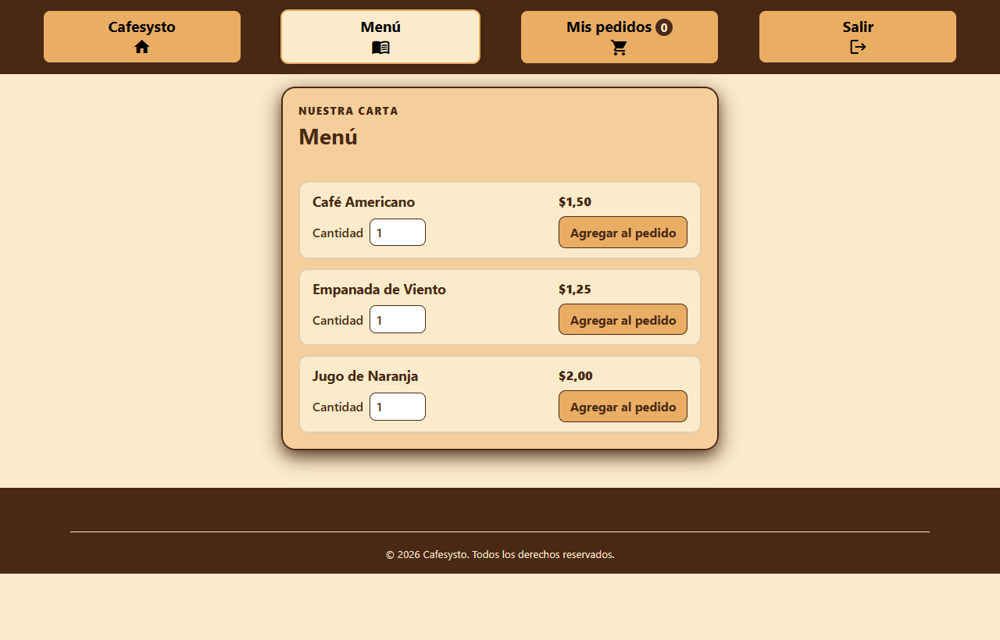

# CPM-02 — Consulta del menú por parte del Cliente

## Descripción

Comprobar que el Cliente pueda consultar el menú visualizando exclusivamente los productos marcados como **Disponible** con su nombre y precio vigente, ocultando los artículos en estado **No disponible**.

## Trazabilidad

**Historia de Usuario:** RFM-01
**Issue:** #35
**Pull Request:** Pendiente

**Criterio(s) de aceptación relacionado(s):**
- El sistema muestra todos los productos marcados como "Disponible".
- Cada producto muestra su nombre y su precio.
- Los productos no disponibles no se muestran en el menú para evitar confusión con el cliente.
- El menú muestra información actualizada.

## Precondiciones

- Existen cuatro productos registrados en el sistema: `Café Americano` (`$1,50`, Disponible), `Empanada de Viento` (`$1,25`, Disponible), `Jugo de Naranja` (`$2,00`, Disponible) y `Sánduche Mixto` (`$2,50`, No disponible).
- El usuario ha iniciado sesión como **Cliente**.

## Datos de prueba

- Productos visibles esperados: `Café Americano` (`$1,50`), `Empanada de Viento` (`$1,25`) y `Jugo de Naranja` (`$2,00`).
- Producto oculto esperado: `Sánduche Mixto` (No disponible).

## Procedimiento de prueba

1. Iniciar sesión con una cuenta de Cliente.
2. Pulsar **Menú** en la barra de navegación superior.
3. Verificar los productos listados y confirmar que `Sánduche Mixto` no aparece en la vista.

## Resultados esperados

El menú muestra únicamente los tres productos disponibles con sus precios vigentes y omite `Sánduche Mixto`.

## EJECUCIONES DEL CASO DE PRUEBA

### Ejecución 1

**Fecha:** 2026-11-24  
**Responsable:** Juan Chugá

#### Resultados obtenidos

Al abrir **Menú**, el sistema mostró únicamente `Café Americano` (`$1,50`), `Empanada de Viento` (`$1,25`) y `Jugo de Naranja` (`$2,00`). El producto `Sánduche Mixto` (No disponible) no apareció en el menú.

#### Estado

- [x] Aprobado
- [ ] Reprobado

#### Capturas o evidencias

---

## Observaciones

- Ninguna.
