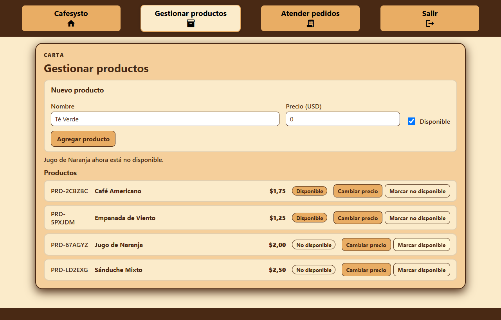
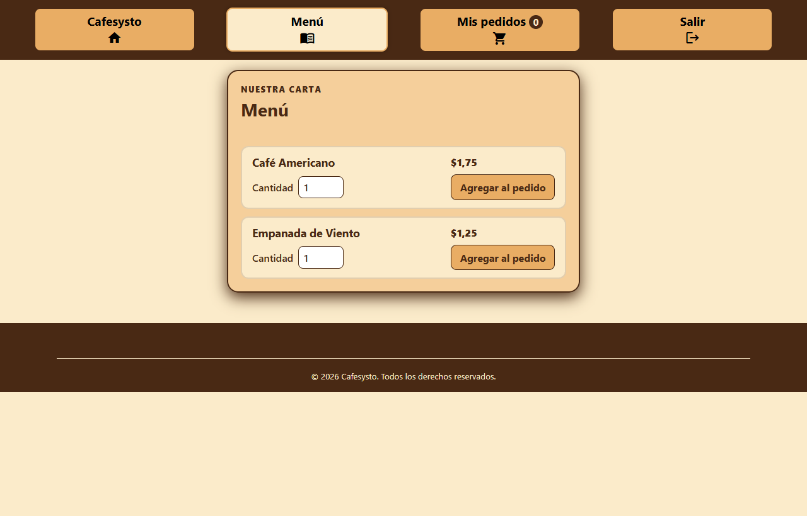
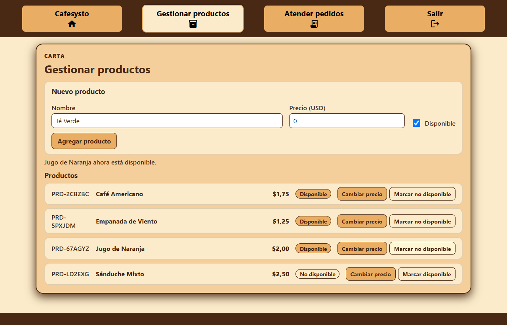

# CPM-04 — Actualización de la disponibilidad de un producto del menú

## Descripción

Comprobar que el Personal pueda cambiar el estado de un producto de **Disponible** a **No disponible** y viceversa, reflejando inmediatamente su ocultamiento y reaparición en el menú del cliente.

## Trazabilidad

**Historia de Usuario:** RFM-03-2
**Issue:** #35
**Pull Request:** Pendiente

**Criterio(s) de aceptación relacionado(s):**
- El sistema permite seleccionar un producto existente del menú para su edición.
- El personal puede cambiar el estado de un producto de "Disponible" a "No disponible" o viceversa.
- Si el producto se ha actualizado correctamente, el sistema muestra un mensaje de éxito y los cambios se ven reflejados en el menú que ven los clientes.

## Precondiciones

- El Personal se encuentra en **Gestionar productos**.
- Existe el producto `Jugo de Naranja` (`PRD-67AGYZ`) en estado **Disponible**.

## Datos de prueba

- **Ejecución 1:** Cambiar `Jugo de Naranja` de `Disponible` a `No disponible`.
- **Ejecución 2:** Cambiar `Jugo de Naranja` de `No disponible` nuevamente a `Disponible`.

## Procedimiento de prueba

1. Ubicar `Jugo de Naranja` en **Gestionar productos** y pulsar **Marcar no disponible**.
2. Comprobar el mensaje de confirmación y verificar en la pestaña **Menú** del Cliente que dejó de mostrarse.
3. Volver al panel de Personal y pulsar **Marcar disponible** sobre el mismo producto.
4. Verificar que la etiqueta regrese a **Disponible** y vuelva a listarse en el menú del Cliente.

## Resultados esperados

- Al marcarlo como no disponible, el producto cambia su etiqueta a `No disponible` y desaparece del menú del cliente.
- Al marcarlo nuevamente como disponible, su etiqueta vuelve a `Disponible` y reaparece en el menú del cliente.

## EJECUCIONES DEL CASO DE PRUEBA

### Ejecución 1

**Fecha:** 2026-11-24  
**Responsable:** Juan Chugá

#### Resultados obtenidos

Al pulsar **Marcar no disponible**, el sistema mostró `Jugo de Naranja ahora está no disponible.`, cambió la etiqueta a `No disponible` y retiró el artículo del menú del cliente (quedando solo `Café Americano` y `Empanada de Viento`).

#### Estado

- [x] Aprobado
- [ ] Reprobado

#### Capturas o evidencias

---

### Ejecución 2

**Fecha:** 2026-11-24  
**Responsable:** Juan Chugá

#### Resultados obtenidos

Al pulsar **Marcar disponible**, el sistema mostró `Jugo de Naranja ahora está disponible.`, actualizó la etiqueta a `Disponible` y el producto volvió a estar habilitado en el menú del cliente.

#### Estado

- [x] Aprobado
- [ ] Reprobado

#### Capturas o evidencias

---

## Observaciones

- Ninguna.
