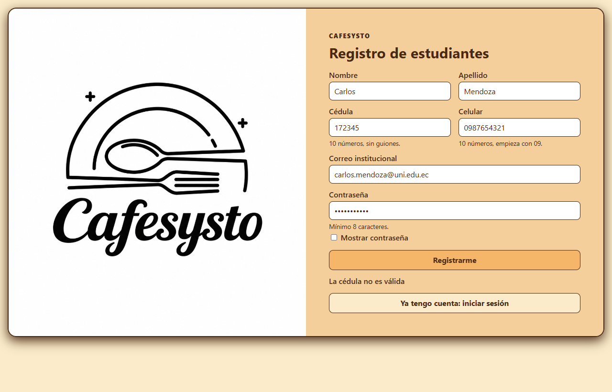
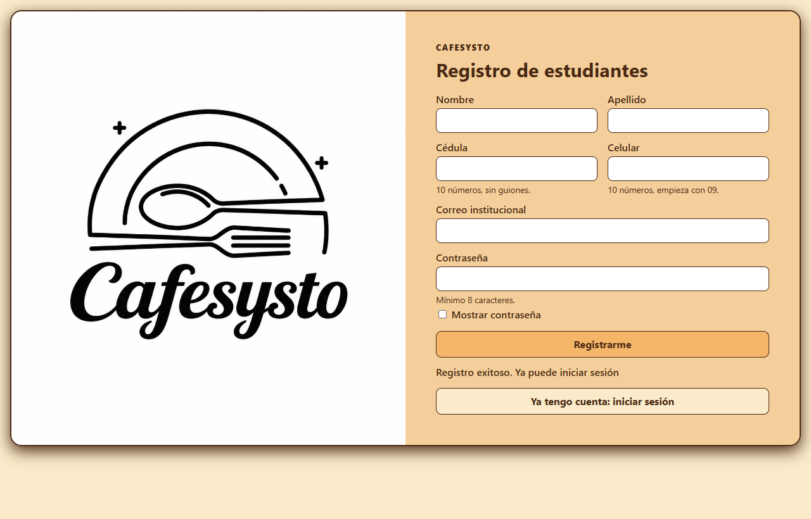

# CPU-01 — Registro de usuario Cliente

## Descripción

Comprobar que el sistema valide correctamente los datos personales al registrar un nuevo Cliente (estudiante o docente), rechace cédulas inválidas y registros duplicados, y guarde al usuario cuando todos los campos cumplen las reglas definidas.

## Trazabilidad

**Historia de Usuario:** RFU-01
**Issue:** #34
**Pull Request:** Pendiente

**Criterio(s) de aceptación relacionado(s):**
- El sistema solicita nombre, apellido, cédula, celular, correo institucional y contraseña.
- Todos los campos son obligatorios; si falta alguno, el registro no se completa y se indica el campo faltante.
- El sistema valida el formato de la cédula, del celular y del correo institucional.
- No se permite registrar una cédula o un correo institucional que ya existan en el sistema; se informa el motivo.
- El sistema muestra un mensaje de confirmación al finalizar el registro exitoso.
- Si los datos no cumplen las validaciones, el sistema informa el motivo y no crea el usuario.

## Precondiciones

- La aplicación está disponible en el navegador.
- El usuario no ha iniciado sesión y accede a la vista **Registro de estudiantes**.
- La cédula `1723456784` y el correo `carlos.mendoza@uni.edu.ec` no existen previamente en la base de datos.

## Datos de prueba

- **Ejecución 1 (cédula inválida):** Nombre `Carlos`, Apellido `Mendoza`, Cédula `172345`, Celular `0987654321`, Correo institucional `carlos.mendoza@uni.edu.ec`, Contraseña `Cliente123!`.
- **Ejecución 2 (datos válidos):** Nombre `Carlos`, Apellido `Mendoza`, Cédula `1723456784`, Celular `0987654321`, Correo institucional `carlos.mendoza@uni.edu.ec`, Contraseña `Cliente123!`.
- **Ejecución 3 (registro duplicado):** Mismos datos válidos de la Ejecución 2 ingresados por segunda vez.

## Procedimiento de prueba

1. Abrir la pantalla de inicio de sesión de Cafesysto y pulsar **Registro estudiantes**.
2. Completar los campos **Nombre**, **Apellido**, **Cédula**, **Celular**, **Correo institucional** y **Contraseña**.
3. Pulsar el botón **Registrarme**.
4. Revisar el mensaje mostrado en pantalla.

## Resultados esperados

- Con una cédula de formato inválido, el sistema impide el registro y muestra un mensaje indicando que la cédula no es válida.
- Con datos válidos y únicos, el sistema guarda al usuario y confirma que ya puede iniciar sesión.
- Al intentar registrar una cédula o correo ya existentes, el sistema rechaza la solicitud e informa el motivo.

## EJECUCIONES DEL CASO DE PRUEBA

### Ejecución 1

**Fecha:** 2026-11-24  
**Responsable:** Jorge Revelo

#### Resultados obtenidos

Al ingresar la cédula incompleta `172345` con el resto de campos válidos, el sistema detuvo el registro y mostró el mensaje: `La cédula no es válida`.

#### Estado

- [x] Aprobado
- [ ] Reprobado

#### Capturas o evidencias

---

### Ejecución 2

**Fecha:** 2026-11-24  
**Responsable:** Jorge Revelo

#### Resultados obtenidos

Al corregir la cédula a `1723456784` y pulsar **Registrarme**, el sistema registró al cliente, limpió el formulario y mostró el mensaje: `Registro exitoso. Ya puede iniciar sesión`.

#### Estado

- [x] Aprobado
- [ ] Reprobado

#### Capturas o evidencias

---

### Ejecución 3

**Fecha:** 2026-11-24  
**Responsable:** Jorge Revelo

#### Resultados obtenidos

Al intentar registrar nuevamente la cédula `1723456784` y el correo `carlos.mendoza@uni.edu.ec`, el sistema impidió la duplicación y mostró el mensaje: `Ya existe un usuario con esa cédula`.

#### Estado

- [x] Aprobado
- [ ] Reprobado

#### Capturas o evidencias

---

## Observaciones

- Las validaciones de formato y unicidad evitaron crear registros inconsistentes o duplicados.
