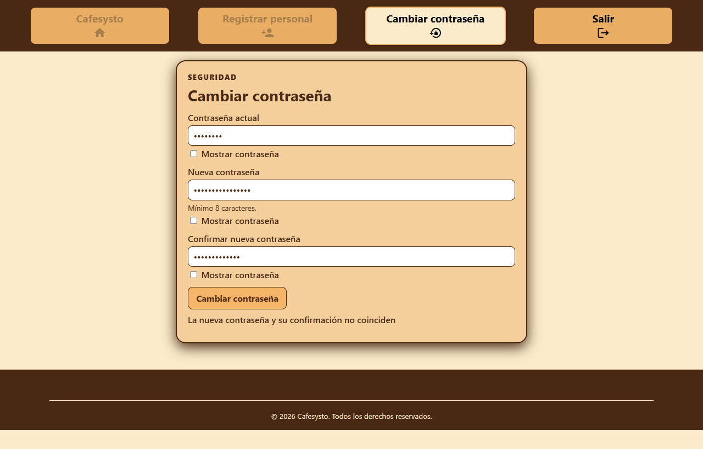
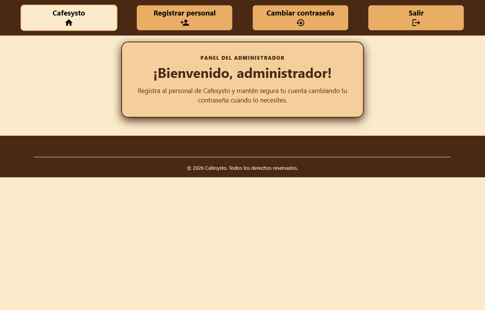
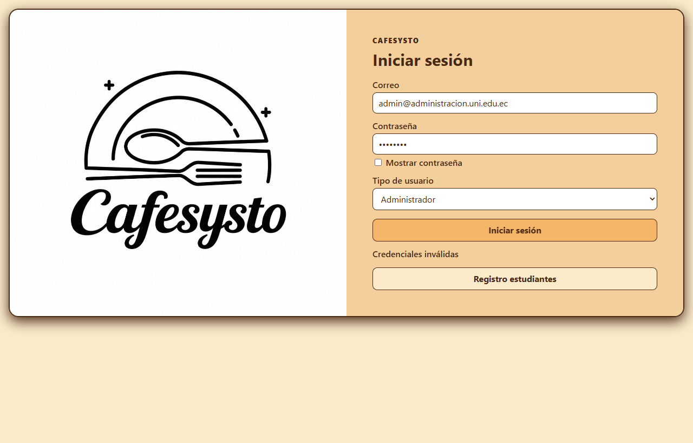

# CPU-03 — Actualización de credenciales de Administrador

## Descripción

Comprobar que en el primer acceso con la clave predeterminada el Administrador deba actualizar su contraseña obligatoriamente, rechazando confirmaciones que no coincidan e invalidando la contraseña anterior una vez completado el cambio.

## Trazabilidad

**Historia de Usuario:** RFU-06
**Issue:** #34
**Pull Request:** Pendiente

**Criterio(s) de aceptación relacionado(s):**
- El sistema solicita la contraseña actual; si no coincide, rechaza el cambio, informa el motivo y no modifica nada.
- La nueva contraseña debe ingresarse dos veces; si ambas no coinciden, el sistema informa el motivo y no realiza el cambio.
- La nueva contraseña debe ser distinta de la contraseña actual.
- Una vez realizado el cambio, el Administrador solo puede ingresar con la nueva contraseña; la contraseña por defecto deja de ser válida.

## Precondiciones

- Existe el usuario Administrador inicial (`admin@administracion.uni.edu.ec`) con su contraseña predeterminada (`admin123`).
- El Administrador inicia sesión por primera vez seleccionando **Tipo de usuario: Administrador**.

## Datos de prueba

- **Ejecución 1 (confirmación distinta):** Contraseña actual `admin123`, Nueva contraseña `AdminSegura2026!`, Confirmar nueva contraseña `OtraClave999!`.
- **Ejecución 2 (cambio válido):** Contraseña actual `admin123`, Nueva contraseña `AdminSegura2026!`, Confirmar nueva contraseña `AdminSegura2026!`.
- **Ejecución 3 (verificación tras cerrar sesión):** Reintento con clave anterior (`admin123`) y posterior ingreso con nueva clave (`AdminSegura2026!`).

## Procedimiento de prueba

1. Iniciar sesión como **Administrador** con las credenciales iniciales y comprobar que se abre la vista **Cambiar contraseña** con las demás opciones deshabilitadas.
2. Ingresar la contraseña actual, la nueva contraseña y su confirmación, y pulsar **Cambiar contraseña**.
3. Cerrar sesión con **Salir**, intentar ingresar con la contraseña anterior y luego iniciar sesión con la contraseña nueva.

## Resultados esperados

- Si la confirmación no coincide, el sistema rechaza el cambio e informa el motivo.
- Si los datos son válidos, se actualiza la contraseña y se habilita la navegación del panel de Administrador.
- Tras cerrar sesión, la contraseña anterior deja de ser válida y solo permite ingresar la nueva contraseña.

## EJECUCIONES DEL CASO DE PRUEBA

### Ejecución 1

**Fecha:** 2026-11-24  
**Responsable:** Jorge Revelo

#### Resultados obtenidos

Al ingresar una confirmación diferente, el sistema rechazó el cambio y mostró el mensaje: `La nueva contraseña y su confirmación no coinciden`.

#### Estado

- [x] Aprobado
- [ ] Reprobado

#### Capturas o evidencias

---

### Ejecución 2

**Fecha:** 2026-11-24  
**Responsable:** Jorge Revelo

#### Resultados obtenidos

Al ingresar la nueva contraseña coincidente en ambos campos y pulsar **Cambiar contraseña**, el sistema aplicó la actualización y desbloqueó el botón **Registrar personal** junto con la pantalla de bienvenida del Administrador.

#### Estado

- [x] Aprobado
- [ ] Reprobado

#### Capturas o evidencias

---

### Ejecución 3

**Fecha:** 2026-11-24  
**Responsable:** Jorge Revelo

#### Resultados obtenidos

Después de cerrar sesión, al intentar ingresar con la contraseña anterior (`admin123`) el sistema mostró `Credenciales inválidas`. Al ingresar con `AdminSegura2026!`, accedió directamente al panel de Administrador con todas sus opciones habilitadas.

#### Estado

- [x] Aprobado
- [ ] Reprobado

#### Capturas o evidencias

---

## Observaciones

- Se verificó tanto el bloqueo inicial del panel como la invalidación inmediata de la contraseña predeterminada.
